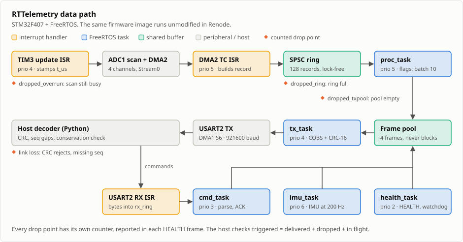
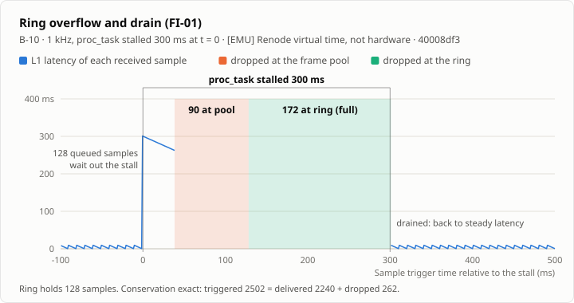
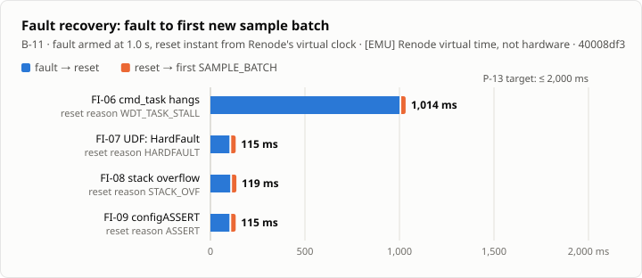
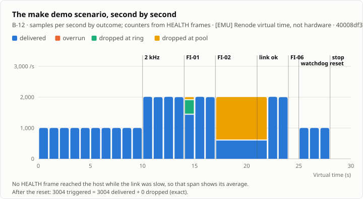
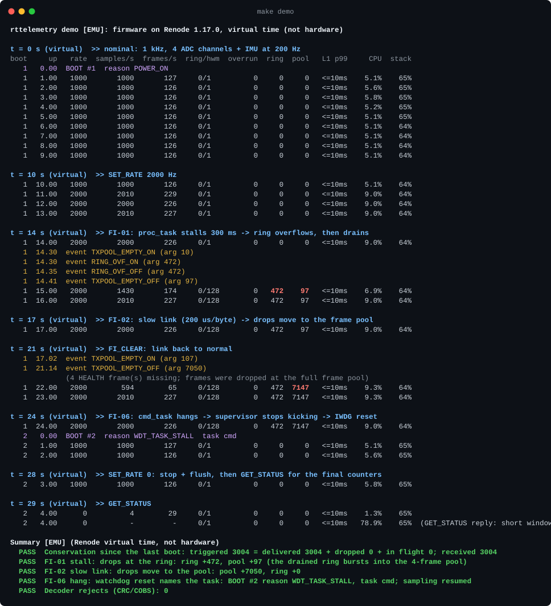

# RTTelemetry

**Real-time sensor telemetry firmware for the STM32F407, in C11 on FreeRTOS. Every sample is
either delivered or counted as dropped at the layer that dropped it.**

[](https://github.com/Eliot-2006/rttelemetry/actions/workflows/ci.yml)

The firmware samples four ADC channels and an LSM6DSO IMU, and streams COBS-framed, CRC-checked
telemetry over UART to a Python host decoder. It runs entirely from static memory (heap: 0 bytes).
A watchdog supervisor, crash records that survive reset, and an uplink command channel with
built-in fault injection make every failure path testable. The same ELF is built for silicon and
runs unmodified in the Renode emulator, where CI runs the full test and benchmark suite.

> [!IMPORTANT]
> **Validation status: emulation and host only.** Every result here comes from **Renode 1.17.0
> emulation** `[EMU]`, a host build `[HOST]`, the linked ELF `[BUILD]` or a paper calculation
> `[CALC]`. **No physical hardware has been used.** Renode timing is deterministic but not
> cycle-accurate, so `[EMU]` latencies and CPU loads are not silicon numbers. The remaining
> hardware work is listed in [docs/hardware.md](docs/hardware.md).



## Results

| What | Result | Bench |
|---|---|---|
| Max zero-loss rate, 4 ADC channels | **2000 Hz** `[EMU]`. At 4 and 8 kHz the emulated ADC (400 µs per scan, D13) overruns; every lost sample is counted | B-01 |
| Sample-to-frame latency (L1) at 1 kHz | p50 5.41 ms, **p99 9.41 ms**, max 9.72 ms `[EMU]` (target p99 ≤ 10 ms) | B-02 |
| 300 ms processing stall | 262 samples lost, all counted (172 at the ring, matching `[CALC]` 172; 90 at the frame pool); latency back to normal right after the stall `[EMU]` | B-10 |
| Fault recovery (hang, HardFault, stack overflow, assert) | Reset reason and task recorded; sampling back in **115–1014 ms** (target ≤ 2000 ms) `[EMU]` | B-11 |
| 30 min soak at 1 kHz | 1 801 802 samples, 0 resets, 0 CRC/COBS rejects, 0 drops, exact conservation `[EMU]` | B-07 |
| Corrupted-frame detection | 100 % of 100 000 frames with 1–3 bit flips or ≤ 16-bit bursts `[HOST]` | B-09 |
| Memory | Heap 0 bytes; worst task stack use 35.7 % (`tx_task`) after the 1 kHz run `[BUILD]`/`[EMU]` | B-04 |

Every value comes from [docs/results.md](docs/results.md), which `make results` generates from the
JSON in `bench/results/`. Each result records its commit, toolchain and Renode version.

<p align="center">
  
  
</p>

## Demo

`make demo` boots the firmware in Renode and drives a 30-second scenario through the uplink: a rate
change, a ring overflow, a slow link, and a task hang that the watchdog resets. A live dashboard
decodes the telemetry, then checks that triggered = delivered + dropped.



<details>
<summary>Full <code>make demo</code> output (recorded from a real run)</summary>



</details>

## Engineering highlights

- **ISR-to-task handoff without locks.** The DMA-complete ISR pushes into a single-producer,
  single-consumer ring with acquire/release atomics and wakes `proc_task` by direct notification.
  The TIM3 ISR runs above the FreeRTOS syscall priority and never calls the kernel.
- **Exact loss accounting.** Overruns, ring drops, frame-pool drops and link loss each have their own
  counter. The host checks conservation exactly after each stop-and-flush, and the Renode tests
  assert it under ring overflow, stress and watchdog recovery (FI-01, IT-STRESS-1, FI-06b).
- **Bounded memory and backpressure.** All kernel objects, stacks and buffers are static. A full
  frame pool drops instead of blocking, so a slow link does not stall acquisition (B-05: 0 ring drops).
- **Fault recovery you can test.** Commands inject hangs, HardFaults, stack overflows, asserts,
  stalls and I²C NACKs. A supervisor stops feeding the IWDG when any task misses its check-in, and a
  `.noinit` crash record reports the reason, task and PC in the next BOOT frame.
- **Determinism.** A golden telemetry capture is byte-identical across runs and Renode processes
  (IT-GOLD-1). The Renode suite passed 20 of 20 back-to-back runs, and a second benchmark run
  reproduced every `[EMU]` number exactly.
- **Emulator divergences documented.** Sixteen differences between Renode 1.17.0 and the
  silicon reference manual (D1–D16), each with its workaround. D16 exposed a real recovery bug: a
  watchdog reset that landed mid-scan could stop acquisition for good. It is fixed and covered by
  regression test FI-06b.

**Stack:** C11 · FreeRTOS V11 · CMSIS register-level drivers (no HAL) · Arm GNU 15.2 · CMake/Ninja ·
Renode + Robot Framework · Unity · libFuzzer · ASan/UBSan/TSan · cppcheck · Python 3.12 · GitHub
Actions.

## Quickstart

```sh
git clone --recursive https://github.com/Eliot-2006/rttelemetry && cd rttelemetry
make bootstrap   # pinned Arm GNU 15.2, Renode 1.17.0, Python venv -> ~/.cache/rttelemetry-tools
make demo        # ~35 s: live dashboard, faults injected, watchdog reset, conservation check
make test        # host unit, TSan stress and Python tests
make test-renode # platform gates + 24 Renode integration and fault-injection tests
make bench-all   # every benchmark (~45 min), then docs/results.md and the charts
```

Requires macOS arm64 or Linux x86_64/arm64, CMake ≥ 3.25, Ninja and Python 3.12. On macOS 27 the
host tests use Homebrew LLVM (`brew install llvm`), because Apple clang 15's ASan aborts at startup.
`make ci-docker` runs the Linux CI path in `ubuntu:24.04`.

## Documentation

| Topic | Where |
|---|---|
| Architecture, invariants, fault handling, Renode divergence register | [docs/design.md](docs/design.md) |
| Wire protocol: COBS + CRC-16, message layouts, worked examples | [docs/protocol.md](docs/protocol.md) |
| Test layers and the integration / fault-injection catalog | [docs/testing.md](docs/testing.md) |
| Benchmarks, with every chart | [docs/results.md](docs/results.md) |
| Response-time analysis tool | [docs/scheduling.md](docs/scheduling.md) |
| Board, pins, remaining hardware work | [docs/hardware.md](docs/hardware.md) |
| Requirements | [docs/PRD.md](docs/PRD.md) |
| Progress log, bugs found by tests, decisions | [docs/progress.md](docs/progress.md) |

## Repository layout

```
src/core/      portable C11 (no RTOS, no hardware): ring, crc16, cobs, frame, msg, cmd, plaus, hist
src/app/       FreeRTOS tasks and ISRs          src/drivers/  register-level CMSIS drivers (no HAL)
src/platform/  linker script, FreeRTOSConfig.h, fault capture
tests/         unit, fuzz, TSan stress, C/Python vectors, Renode platform gates and Robot suites
tools/         Python decoder/CLI (`python -m telemetry`), demo, RTA, feed generator, size budgets
bench/         benchmark runner, report and chart generators
renode/        board overlay, machine script, ADC feed files
docs/img/      generated charts and diagram (`make results`)
```
