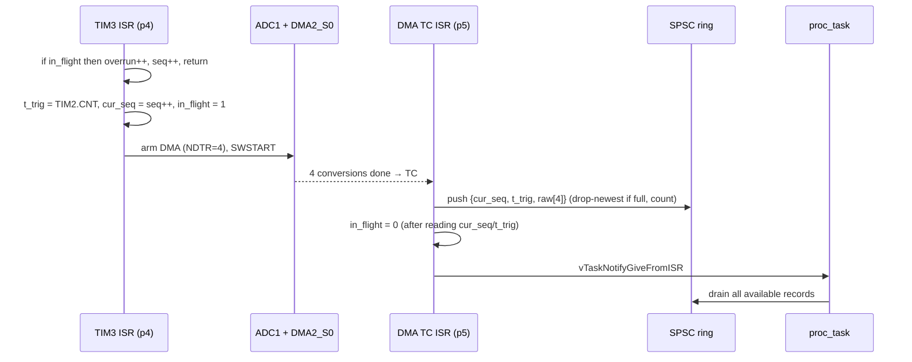

# PRD: FreeRTOS Embedded Sensor Telemetry System

| Field | Value |
|---|---|
| Status | Draft v1.0, ready for M0 |
| Date | 2026-11-09 |
| Target | STM32F407VG (Cortex-M4F) on STM32F4DISCOVERY, emulated in Renode 1.17.0; optional real-board validation |
| Languages | C11 (firmware + portable core), Python 3.11+ (host tools, Robot Framework keywords, benchmarks) |
| Audience | An AI coding agent implementing the project milestone by milestone, and the maintainer reviewing it |

**Keywords.** **MUST** / **SHOULD** / **MAY** are used as in RFC 2119. Requirement IDs (`FR-`, `NFR-`), test IDs (`UT-`, `IT-`, `FI-`, `B-`), and gate IDs (`G-`) are stable: reference them in code comments, tests, and commit messages.

**Result labels.** Every number this project publishes **MUST** carry exactly one label:

| Label | Meaning |
|---|---|
| `[HOST]` | Measured on the development/CI host (unit tests, TSan, fuzzing, Monte Carlo). |
| `[EMU]` | Measured on firmware running in Renode. Uses **virtual time**. Functionally faithful, **not cycle-accurate**. |
| `[HW]` | Measured on a physical STM32F407 board (firmware counters, DWT cycle counter, logic analyzer). |
| `[CALC]` | Derived analytically (link budgets, worst-case sizes). |

---

## 0. How an agent should use this document

1. Work **one milestone at a time** in the order in §22. Do not start milestone N+1 until every acceptance criterion of milestone N passes. Record the evidence (commands run, short output summary, commit-independent) in `docs/progress.md`.
2. **M0 is a feasibility gate.** If a gate fails, apply the listed fallback, record the decision in `docs/design.md` §Decision log, and update this PRD before continuing. Do not silently work around an emulator gap.
3. **Never fabricate measurements.** `docs/results.md` is generated **only** by `bench/report.py` from JSON produced by benchmark runs. Do not hand-edit numbers.
4. **Never present `[EMU]` timing as hardware timing.**
5. Keep `src/core/` free of hardware and RTOS includes (§6.3). CI enforces this.
6. Pin every external dependency (§5.5). Add a dependency only with a Decision-log entry that states why.
7. **Do not `git commit`, `git push`, merge, or rebase.** The maintainer commits. Leave changes in the working tree and summarize them.

---

## 1. Executive summary

A FreeRTOS firmware for an STM32F407 acquires multi-channel analog measurements (ADC + DMA, timer-triggered at 1 kHz). A lock-free single-producer/single-consumer ring buffer moves samples from interrupt context to a processing task. The task validates samples, timestamps them, batches them into a versioned, CRC-protected, COBS-framed binary protocol, and streams the frames over UART using DMA. A command uplink supports runtime configuration and **deterministic fault injection**. A task-liveness watchdog, crash records that survive reset, and loss accounting at every queue keep the system observable and recoverable under fault.

The **same `.elf`** runs unmodified in Renode (CI) and on a real STM32F4DISCOVERY board. A small Renode platform overlay makes the emulated clocks match silicon. Sensor inputs are injected **at the peripheral-model level** (Renode ADC model feed files and the LSM6DSO IMU model's RESD data), so the real driver code runs in both environments.

**Headline engineering properties** (each is tested and reported):
- **Loss accounting conservation:** every acquired sample is either delivered or counted as dropped at a named layer. Tests check this with an exact equality.
- **Deterministic emulation:** identical inputs produce identical decoded telemetry across runs, enforced with golden files in CI.
- **Bounded memory:** no heap. All memory is statically allocated, with CI-enforced flash/RAM budgets and stack margins.
- **Explicit concurrency design:** every shared variable has a documented owner, writer, reader, and protection mechanism (§17).
- **Fault tolerance:** 11 fault-injection scenarios in the core set, plus 2 IMU scenarios in M7 (consumer stall, link backpressure, corrupted uplink, task hang, HardFault, stack overflow, assert, sensor faults, ADC overrun, downlink corruption, I²C bus faults). Each has a pass/fail criterion.

---

## 2. Critical evaluation of the brief

The brief is well targeted. It names the right concerns (ISR/task separation, bounded buffers, deterministic testing) and avoids a fake desktop RTOS. The changes below make it stronger or remove risk.

| # | Brief said / implied | PRD decision | Why |
|---|---|---|---|
| 1 | "Deterministic virtual sensor measurements" | Inject data **through emulated peripherals**: the STM32 ADC model (feed files) and the LSM6DSO IMU model (RESD). No sensor generator inside the firmware. | A generator inside the firmware makes acquisition fake. Injecting at the peripheral model means the real ADC/DMA/I²C driver code runs in emulation and on hardware. |
| 2 | UART + timers first; SPI/I²C later | Primary path: **TIM → ADC scan → DMA → ISR → ring**. Secondary (P1): **I²C IMU with data-ready interrupt**. SPI is a non-goal. | Timer-triggered ADC with DMA is the most common real acquisition pattern and exercises timers, ADC, DMA, NVIC priorities, and ISR handoff together. One bus sensor is enough; SPI and I²C together add breadth without depth. |
| 3 | No physical hardware | Hardware is **never required for CI or for M0–M8**. An optional ~US$60–90 kit (§5.3) unlocks milestone M9 (`[HW]` numbers). The board is chosen so **the same binary runs in both**. | Interviewers routinely ask "did it run on real hardware?" A cheap, optional validation tier turns emulated claims into measured ones without making the project depend on hardware. |
| 4 | C++ for host utilities | **Python** for all host tooling. | Robot Framework keyword libraries are Python, and Python's standard library has the CRC used (`binascii.crc_hqx`). One host language means one decoder used by tests, benchmarks, the demo, and hardware validation. C++ would add a second toolchain with no benefit. |
| 5 | Custom ring buffer vs FreeRTOS queues: evaluate | Custom **SPSC lock-free ring** for ISR→task sample and UART-RX paths. **FreeRTOS queues** for multi-producer paths (event log) and buffer-ownership passing. Analysis in §9.6. | Each mechanism is used where it is the right tool. The custom ring is justified by explicit overflow policy, no critical sections in the ISR, built-in metrics, and host testability with ThreadSanitizer. |
| 6 | Optional RMS/EDF scheduler module | **No scheduler simulator.** A ~150-line response-time-analysis (RTA) script plus a controlled priority-inversion experiment (M8, P1). | RTA checked against measured response times is more defensible and much cheaper than a simulator. |
| 7 | Metrics list includes throughput and latency | Each metric is defined with its environment, method, and meaning (§20). UART throughput is **not** reported as `[EMU]`, because Renode does not model baud timing. | This avoids the most common emulator-metrics mistake. |
| 8 | Board-specific startup from a known-good example | Use ST's `cmsis-device-f4` startup and system files plus Arm's CMSIS-Core. Write a ~100-line linker script based on ST's CubeF4 template. Use **register-level drivers, no HAL**. | Renode models peripherals at the register level, so register-level drivers are easier to debug against the model. HAL polling loops sometimes wait on flags Renode does not model. Small drivers (~1–1.5k LOC total) are fully explainable in interviews. |
| 9 | (Not mentioned) | Add **fuzzing** of the uplink frame decoder and command parser. | The uplink is the firmware's only trust boundary. Fuzzing is cheap and finds real bugs. |
| 10 | (Not mentioned) | Keep a documented **Renode divergence register** (§3.3) and runtime guards for divergences that would hide hardware bugs, such as DMA buffers placed in CCM RAM. | Emulation can pass where hardware would fail. Naming these cases is part of engineering honesty and a strong interview topic. |

---

## 3. Platform feasibility (verified 2026-11-09)

### 3.1 Verified by reading Renode sources (`renode/renode` and `renode/renode-infrastructure` `master`; release v1.17.0, 2026-09-07)

| Item | Finding | Evidence | Implication |
|---|---|---|---|
| Board | `platforms/boards/stm32f4_discovery.repl` → `platforms/cpus/stm32f4.repl` (Cortex-M4, F40x SVD applied) | repl files | Use STM32F4DISCOVERY (STM32F407VG). |
| UART | `usart1–3`, `uart4–5` as `STM32_UART`. **`TXE` always reads 1** (TX is instantaneous). **`DMAT` is a tagged, unimplemented flag.** `DMAR` (RX DMA request) and `IDLE` are implemented. | `STM32_UART.cs` | Emulated link has **unlimited bandwidth**, so link throughput and backpressure are `[HW]`-only or need fault injection. |
| DMA | `dma1`, `dma2` as `STM32DMA`. Peripheral→memory transfers are request-driven. Memory→peripheral and memory→memory **complete immediately when the stream is enabled**. **`CIRC`, `DBM`, `HTIF/HTIE`, `TEIF/TEIE` are tagged (unimplemented).** `TCIF/TCIE` work. | `STM32DMA.cs` | **No circular or half-transfer DMA.** Design re-arms a normal-mode stream per scan (§7.3). UART TX DMA works functionally, with no timing. |
| ADC | **No ADC in `stm32f4.repl`.** `Analog.STM32_ADC` (used for STM32F7, same ADC IP as F4) supports software trigger, scan, continuous, EOC IRQ, DMA request, and `FeedSample(path, channel)`. **Not implemented:** external triggers, overrun, sampling time, injected channels. | `STM32_ADC.cs`, `stm32f777.repl` | Add `adc1` in a project overlay at `0x40012000`, IRQ 18, DMA request → `dma2` stream 0. Use **software trigger from the timer ISR** (§7.3). |
| Timers | `timer1–14` as `STM32_Timer`, **fixed `frequency: 10000000`** regardless of RCC. NVIC `systickFrequency: 72000000`. | `stm32f4.repl` | Overlay **must** override the APB1 timer clock to 84 MHz and SysTick to 168 MHz, or prescaler math and FreeRTOS tick rate diverge from silicon. Overriding properties after `using` has precedent (`ramn.repl`). |
| I²C | `i2c1–3` as `STM32F1_I2C` (F1 and F4 share the I²C v1 IP). | `stm32f4.repl` | I²C is usable, but model fidelity for interrupt-driven state machines is unverified (gate G7). |
| IMU model | `Sensors.LSM6DSO_IMU`: I²C + SPI, `IUnderstandRESD` for accel/gyro/temp, `Interrupt1` GPIO with `INT1_DRDY_XL/G`. | `LSM6DSO_IMU.cs` | A real, purchasable part with RESD-driven data and a data-ready interrupt. |
| Watchdog | `iwdg` (`STM32_IndependentWatchdog`, 32 kHz) calls `machine.RequestReset()`. | source | Watchdog reset is testable. |
| Reset cause | `RCC_CSR` reset flags are **constant tags** (reads `0x0E000000`). `IWDGRSTF` never sets. | `STM32F4_RCC.cs` | Reset cause **MUST** come from a software `.noinit` record (§14.3). `RCC_CSR` is supplementary (`[HW]` only). |
| RAM across reset | `MappedMemory.Reset()` is a no-op: RAM persists across machine reset. | `MappedMemory.cs` | `.noinit` crash records work in emulation. They also work on silicon for warm resets. |
| CCM RAM | Not mapped in `stm32f4.repl` (F407 has 64 KiB at `0x10000000`). | repl | Overlay adds it. On silicon, **DMA cannot access CCM**; Renode will not enforce this (§3.3). |
| DWT | `DWT` model exists; `CYCCNT` is driven by **virtual time**. | `Cores/Arm-M/DWT.cs` | `[EMU]` cycle counts are a virtual-time proxy only. Real cycle counts are `[HW]`. |
| UART capture | `CreateFileBackend(path, immediateFlush)` and `ServerSocketTerminal` exist. | `UartFileBackend.cs` | Robot tests capture binary UART output to a file and decode it in Python. The demo streams over TCP. |
| Distribution | v1.17.0 assets include `linux-portable`, `linux-arm64-portable`, `osx-arm64-portable.dmg`. CI action `antmicro/renode-test-action` v5.2.1 exists. | GitHub releases | Works on Ubuntu CI and Apple Silicon development machines. |
| Deps (latest at time of writing) | FreeRTOS-Kernel V11.3.x; Unity v2.7.0; CMSIS_6 v6.4.0; `cmsis-device-f4` has GCC startup for F407 but **no GCC linker script**. | GitHub | Pin exact versions in M0. Write the linker script. |

### 3.2 Not verifiable by reading source; resolved by gates in M0

Runtime behavior must be proven by gates G1–G11 (§22, M0): RCC/PLL bring-up passes, overlay overrides take effect, UART TX via immediate DMA delivers bytes in order, the ADC overlay works with F4 register offsets and DMA, FreeRTOS tick accuracy, BASEPRI masking, LSM6DSO over the I²C v1 model, `.noinit` survives an IWDG reset, `UDF` raises a HardFault, Robot-to-UART binary I/O works, and everything runs headless in CI.

### 3.3 Renode divergence register (maintained in `docs/design.md`)

| ID | Divergence | Hazard | Guard |
|---|---|---|---|
| D1 | UART TX instantaneous; baud not modeled | Overstates throughput, hides backpressure | Link metrics are `[HW]`/`[CALC]` only; fault-injection hook FI-02 emulates a slow link |
| D2 | No circular / half-transfer DMA | Design that uses them would fail in CI | Normal-mode DMA re-armed per scan on both targets |
| D3 | No ADC external trigger | Timer-TRGO triggering would not work in emulation | Software trigger from the timer ISR on both targets; hardware-trigger variant documented as an `[HW]`-only improvement |
| D4 | DMA can reach any address (incl. CCM) | A buffer in CCM works in Renode, **fails silently on silicon** | Linker places DMA buffers in `.dma_ram` (SRAM1); `DMA_BUF_ASSERT(ptr)` checks address range at init |
| D5 | Unmapped accesses are logged and read as 0 (no BusFault) | Wild-pointer bugs hidden in emulation | Fault injection uses `UDF` (undefined instruction); bus-fault scenarios are `[HW]` only |
| D6 | `RCC_CSR` reset flags constant | Reset cause invisible | `.noinit` reset record (§14.3) |
| D7 | Factory calibration ROM (`VREFINT_CAL`, `TS_CAL`) reads 0 | Divide-by-zero if device converts units | Device sends raw counts; host converts. Calibration constants are sent in the BOOT frame, and host falls back to nominal values if invalid |
| D8 | Timing is instruction-count/virtual-time based, not cycle-accurate | Latency/jitter overstated or understated | `[EMU]` vs `[HW]` labeling; HW cross-check in M9 |
| D9 | ADC sampling time not modeled | Conversion latency differs | Not used in any `[EMU]` timing claim |

---

## 4. Goals, scope, deliverables, non-goals

### 4.1 Goals
- **G-1** Real FreeRTOS firmware on an emulated STM32F407 in Renode, with the same binary validated on silicon (optional tier).
- **G-2** Deterministic, timer-triggered acquisition with a correct and demonstrably safe ISR→task handoff.
- **G-3** A robust, versioned binary telemetry protocol with integrity checks, sequence tracking, and complete loss accounting.
- **G-4** Predictable behavior under overload and faults: explicit overflow policies, a watchdog, crash records, recovery.
- **G-5** Automated verification at every layer (host unit tests, concurrency stress, fuzzing, Renode integration, fault injection), running in CI with no hardware.
- **G-6** Reproducible, honestly labeled metrics for throughput, latency, memory, integrity, and reliability.

### 4.2 Scope tiers

| Tier | Milestones | Contents |
|---|---|---|
| **MVP** | M0–M3 | Boots in Renode; FreeRTOS; TIM→ADC→DMA→ISR→ring→task; COBS/CRC frames over UART DMA; BOOT/HEALTH frames; deterministic golden test in CI |
| **Resume-ready** (target) | + M4–M6, M10 | Uplink commands, fault-injection suite, watchdog/crash records, loss accounting, benchmarks, generated `results.md`, demo video |
| **Advanced** (P1) | M7, M8, M9 | I²C IMU with bus recovery; RTA + priority-inversion experiment; hardware validation with `[HW]` metrics |

### 4.3 Deliverables
Public repository containing: buildable firmware (CMake), `FreeRTOSConfig.h`, startup/linker/system files, Renode overlay and scripts, `src/` firmware and core library, `tests/` (unit, stress, fuzz, Robot, HIL), `bench/` scripts and results JSON, `tools/telemetry` host decoder/CLI, `docs/design.md`, `docs/results.md`, `docs/protocol.md`, `docs/testing.md`, `docs/hardware.md`, `docs/platform-verification.md`, `docs/progress.md`, CI workflows, a one-command demo (`make demo`), and a recorded demo (≤ 3 min).

### 4.4 Non-goals
GUI dashboards; networking (Ethernet/TCP/IP on the target); filesystems or SD logging; bootloader or OTA updates; SPI peripherals; low-power modes; a standalone scheduler simulator; floating-point DSP or filtering beyond plausibility checks; MISRA *compliance* claims (a MISRA-inspired rule subset is fine); multi-board/multi-node systems; authentication or encryption of the uplink (documented as out of scope; fault injection is compiled out of release builds).

### 4.5 Anti-goals (failure even if it "works")
- Timing numbers from Renode presented without the `[EMU]` label, or framed as hardware performance.
- A desktop "RTOS simulation" (e.g., FreeRTOS POSIX port) used in place of emulated-MCU integration tests.
- Flaky integration tests (any assertion that depends on wall-clock time).
- Silent data loss: any sample that is neither delivered nor counted.
- Dynamic memory allocation after `vTaskStartScheduler()`. The target is no heap at all.
- Features that add code without adding engineering depth.

---

## 5. Hardware, platform, and development setup

### 5.1 Target
- **MCU:** STM32F407VGT6 (Cortex-M4F, 168 MHz max, 1 MiB flash, 128 KiB SRAM1/2 at `0x20000000`, 64 KiB CCM at `0x10000000`).
- **Board:** STM32F4DISCOVERY (order code **STM32F407G-DISC1**). It is Renode's stock STM32F4 board.
- **Clocking (both targets):** HSE 8 MHz → PLL → SYSCLK 168 MHz; AHB 168, APB1 42 (timers 84), APB2 84 (timers 168). Flash latency 5 WS, prefetch, I/D cache enabled.
- **Linker memory regions:** use the **silicon** sizes (FLASH 1 MiB, SRAM 128 KiB, CCM 64 KiB), even though Renode maps 2 MiB / 256 KiB, so the binary is valid on both.

### 5.2 Renode overlay: `renode/telemetry_board.repl`
```
using "platforms/boards/stm32f4_discovery.repl"

nvic:
    systickFrequency: 168000000        // match HCLK for FreeRTOS SysTick

timer2:                                 // APB1 timers run at 84 MHz on silicon
    frequency: 84000000
timer3:
    frequency: 84000000

ccm: Memory.MappedMemory @ sysbus 0x10000000
    size: 0x10000

adc1: Analog.STM32_ADC @ sysbus 0x40012000
    IRQ -> nvic@18
    DMARequest -> dma2@0               // ADC1 -> DMA2 Stream0 (Ch0 on silicon)

// M7 (P1): IMU on I2C1, INT1 -> EXTI-capable GPIO (pin finalized in M0, see §5.4)
// imu: Sensors.LSM6DSO_IMU @ i2c1 0x6A
//     Interrupt1 -> gpioPortX@N
```
The syntax above is a starting point. Gate G1/G2/G6 confirm it (exact connection syntax, whether `cpu: PerformanceInMips` should be set, ADC common-register tagging at `0x40012300`). Record the final form and the reasons in `docs/platform-verification.md`.

`renode/telemetry.resc` creates the machine, loads the overlay, loads `$elf`, attaches ADC feed files and RESD data, and connects `usart2` to either a file backend (tests) or a server socket terminal (demo). It sets Renode time/quantum settings explicitly and documents them.

### 5.3 Optional hardware kit (M9 only; approx. prices, 2026)

| Item | Purpose | Approx. |
|---|---|---|
| STM32F407G-DISC1 | Target; on-board ST-LINK for flash/debug | US$25–35 |
| 3.3 V USB-UART adapter (CP2102N or FT232R; must support ≥ 921600 baud) | Telemetry link (avoids board-revision differences in on-board VCP support) | US$8–15 |
| SparkFun LSM6DSO breakout (exact part, matches Renode model; LSM6DSOX is an acceptable fallback, verify register differences) | M7 IMU on hardware | US$12–15 |
| 10 kΩ potentiometer, resistors, jumper wires, breadboard | ADC inputs | US$5–10 |
| 8-channel 24 MHz USB logic analyzer (sigrok/PulseView compatible) | **Independent** latency/jitter validation | US$12–20 |

Total: ~US$60–95. Flash and debug use OpenOCD + `arm-none-eabi-gdb`, the same GDB workflow as Renode's built-in GDB server (`machine StartGdbServer 3333`). `probe-rs` is an acceptable alternative.

**Alternatives considered:** NUCLEO-F446RE (cheaper, on-board VCP, but F446 is not modeled in Renode, which breaks the "same binary" property); STM32F429I-DISC1 (modeled CPU, more complex board, no benefit here).

### 5.4 Pin plan (finalize against UM1472 in M0; record in `docs/hardware.md`)

| Function | Peripheral | Candidate pins | Notes |
|---|---|---|---|
| Telemetry link | USART2 TX/RX (AF7) | PA2 / PA3 | 921600 baud: BRR from 42 MHz gives −0.93 % error `[CALC]` (acceptable < 2 %); 1 000 000 baud gives 0 % if the adapter supports it |
| ADC ch0 | ADC1_IN1 | PA1 | Potentiometer |
| ADC ch1 | ADC1_IN8 | PB0 | Resistor divider |
| ADC ch2 | ADC1_IN16 | internal | Temperature sensor (needs ≥ 10 µs sampling time on silicon) |
| ADC ch3 | ADC1_IN17 | internal | VREFINT (lets host compute VDDA) |
| IMU (P1) | I2C1 SCL/SDA, INT1→EXTI | PB8/PB9 (or PB6/PB9), EXTI pin TBD | I2C1 is shared with the on-board CS43L22 codec (addr `0x4A`); hold codec reset (PD4) low. No address conflict with `0x6A` |
| Timing markers | GPIO | PD12–PD15 (on-board LEDs) | Logic-analyzer probes: ISR, proc task, TX DMA active, fault |

### 5.5 Toolchain and pinned dependencies

| Component | Version policy | Source / mechanism |
|---|---|---|
| Arm GNU Toolchain (`arm-none-eabi-gcc`) | Latest stable at M0 start; exact version + SHA-256 pinned in `scripts/bootstrap.sh` | developer.arm.com tarballs (Linux x86_64, macOS arm64) |
| Renode | **1.17.0** | Portable package (Linux), `.dmg` (macOS arm64) |
| FreeRTOS-Kernel | Latest V11 tag at M0 (V11.3.x as of 2026-11), port `GCC/ARM_CM4F` | git submodule `third_party/FreeRTOS-Kernel` |
| CMSIS-Core | CMSIS_6 v6.4.0 (fallback: CMSIS_5 5.9.0 if device headers are incompatible) | submodule, Core headers only |
| ST device files | `STMicroelectronics/cmsis-device-f4`, pinned commit | submodule: `stm32f407xx.h`, `system_stm32f4xx.c`, `startup_stm32f407xx.s` (gcc) |
| Unity | v2.7.0 | submodule |
| CMake / Ninja | CMake ≥ 3.25, Ninja | system |
| Host compilers | GCC ≥ 12 and Clang ≥ 16 (Clang required for TSan/libFuzzer on macOS) | system |
| Python | 3.11+; `requirements.txt` pinned: Renode's Robot Framework requirement set, `pyserial` (HW only), `gcovr` | pip |
| Static analysis | `cppcheck` (pinned) | system / CI |

`make bootstrap` installs the pinned toolchain and Renode into `.tools/` on Linux x86_64/arm64 and macOS arm64. CI runs **the same make targets** as local development.

### 5.6 Driver approach: CMSIS register-level, no HAL
- **Chosen:** direct register access via CMSIS device headers. Drivers: `clock`, `gpio`, `uart_dma`, `tim`, `adc_dma`, `iwdg`, `i2c` (P1), `exti` (P1).
- **Tradeoff:** more code than STM32Cube HAL/LL, but every register write is explainable, binaries are smaller, and debugging against Renode's register-level models is direct. HAL is rejected. ST LL headers are an acceptable shortcut **only** for RCC/GPIO boilerplate, if they compile cleanly with pinned device headers.

---

## 6. System architecture

### 6.1 Data flow
```mermaid
flowchart LR
  subgraph ISR["Interrupt context"]
    TIM3["TIM3 update ISR<br/>prio 4 (above kernel)<br/>stamp t, seq++, arm DMA, SWSTART"]
    DMA["DMA2_S0 TC ISR<br/>prio 5<br/>push record, notify"]
    RX["USART2 RXNE ISR<br/>prio 7<br/>push byte, notify on 0x00"]
    TXC["DMA1_S6 TC ISR<br/>prio 7<br/>return buffer, notify"]
  end
  subgraph TASK["Task context (FreeRTOS)"]
    PROC["proc_task<br/>validate, batch, frame"]
    TX["tx_task<br/>owns UART TX DMA"]
    CMD["cmd_task<br/>uplink, fault injection"]
    HEALTH["health_task<br/>watchdog supervisor, HEALTH/EVENT frames"]
  end
  ADC[(ADC1 scan 4ch)] --> DMA
  TIM3 --> ADC
  DMA -->|SPSC ring 128 × record| PROC
  PROC -->|tx_q: buffer index| TX
  HEALTH -->|tx_q| TX
  TX --> UART[(USART2 TX DMA)]
  TXC -->|free_q: buffer index| PROC
  RX -->|SPSC ring 256 B| CMD
  ANY["any task / ISR"] -->|event_q (FreeRTOS queue)| HEALTH
```

### 6.2 Execution contexts
| Context | Allowed | Forbidden |
|---|---|---|
| ISR above `configMAX_SYSCALL_INTERRUPT_PRIORITY` (TIM3) | Register access, writes to ISR-private state | **Any** FreeRTOS API (`configASSERT` in `vPortValidateInterruptPriority` catches violations) |
| ISR at or below syscall priority | `*FromISR` APIs, ring push, `portYIELD_FROM_ISR` | Blocking, loops over unbounded data, `printf`, float in ISRs |
| Tasks | Blocking with **bounded** timeouts, queues, notifications | Busy-wait > 50 µs; unbounded blocking in any watchdog-monitored task |

### 6.3 Module layering (enforced)
```
src/app/        tasks, wiring, configuration           → may use everything
src/drivers/    register-level drivers                 → platform, CMSIS, (FreeRTOS only for notifications)
src/platform/   startup, linker, system, fault handlers, FreeRTOSConfig.h
src/core/       ring, crc16, cobs, frame, cmd, plaus, hist   → C11 + <stdint.h>/<string.h>/<stdatomic.h> ONLY
```
- `src/core/` **MUST** compile for the host with no CMSIS/FreeRTOS include paths. CI builds it standalone, which enforces this.
- Drivers expose minimal APIs. No "HAL interface" abstraction with a single implementation.
- The **same source** builds for Renode and silicon. **No `#ifdef RENODE`** in firmware. Environment differences live in the Renode overlay. If an unavoidable difference is found, it requires a Decision-log entry.

---

## 7. Interrupts and DMA

### 7.1 NVIC priority plan (4 priority bits; lower number = more urgent; `configMAX_SYSCALL_INTERRUPT_PRIORITY = 5`)
| IRQ | Prio | Calls RTOS API | Work | WCET budget `[HW]` |
|---|---|---|---|---|
| TIM3 update (sample trigger) | **4** | **No** | Clear UIF; if a scan is in flight → `adc_overrun++`, `seq++`, return; else capture `TIM2->CNT`, assign `seq`, re-arm DMA2_S0 (NDTR=4), set `ADC_CR2.SWSTART` | ≤ 1 µs |
| DMA2_Stream0 (ADC scan complete) | 5 | Yes | Clear TCIF; build record {seq, t, raw[4]}; `ring_push`; clear in-flight flag **last**; `vTaskNotifyGiveFromISR(proc)` | ≤ 3 µs |
| EXTI (IMU DRDY, P1) | 6 | Yes | Stamp time; notify `imu_task` | ≤ 1 µs |
| I2C1 EV/ER (P1) | 6 | Yes | Transaction state machine; notify on completion or error | ≤ 3 µs |
| DMA1_Stream6 (USART2 TX complete) | 7 | Yes | Clear TCIF; `xTaskNotifyFromISR(tx_task)` | ≤ 2 µs |
| USART2 (RXNE/ORE) | 7 | Yes | Read DR; `ring_push` byte (drop + count if full); notify `cmd_task` on `0x00` delimiter; count ORE | ≤ 2 µs |
| SysTick, PendSV | 15 | Kernel | | |

**Why TIM3 sits above the kernel threshold:** FreeRTOS critical sections mask priorities ≥ 5 via BASEPRI. Placing the trigger ISR at 4 removes kernel critical sections from its latency path, so sampling jitter is bounded by higher-priority ISRs and hardware effects only. The cost: it cannot use the RTOS. It doesn't need to.

### 7.2 DMA streams (STM32F407 mapping per RM0090)
| Stream | Channel | Direction | Mode | Use |
|---|---|---|---|---|
| DMA2_Stream0 | 0 | ADC1_DR → `scan_buf[4]` (SRAM1) | **Normal**, re-armed per scan, 16-bit, MINC | Acquisition |
| DMA1_Stream6 | 4 | frame buffer → USART2_DR | Normal, 8-bit, MINC | Telemetry TX |
| (none) | | USART2 RX | Interrupt per byte (uplink is low rate) | Commands |

### 7.3 Acquisition sequence (per sample period)

- `seq` is assigned **at trigger time**, so a loss at any layer (overrun, ring, frame pool) appears downstream as a sequence gap. It is also counted at the layer where it occurs.
- **Invariant I-ACQ-1:** `t_trig` and `cur_seq` are written only by TIM3 ISR while `in_flight == 0`, and read only by the DMA ISR while `in_flight == 1`. The DMA ISR clears `in_flight` after reading them. (TIM3 can preempt the DMA ISR; this ordering makes that safe.)
- Hardware-trigger variant (TIM TRGO → ADC EXTSEL) gives zero trigger jitter on silicon but is not modeled in Renode (D3). It is **not** used, to keep one binary. Documented as a tradeoff.

### 7.4 UART TX (frame buffers)
`tx_task` dequeues a buffer index from `tx_q`, programs DMA1_S6 (M0AR = buffer, NDTR = length), enables USART `DMAT`, starts the stream, and waits for the TC notification **with timeout** (`2 × len × 10 / baud + 5 ms`). On timeout it counts `tx_timeout`, aborts the stream, logs an event, and still returns the buffer. In Renode the transfer completes immediately (D1). On silicon it takes `len × 10 / baud`.

---

## 8. FreeRTOS task architecture

### 8.1 Tasks (all statically allocated)
| Task | Prio | Trigger | Deadline (derivation) | Stack (initial, words) | Responsibility |
|---|---|---|---|---|---|
| `imu_task` (P1) | 6 | DRDY notify (208 Hz) | 4.8 ms (next DRDY overwrites data) | 256 | I²C burst read, push IMU sample to `imu_q` |
| `proc_task` | 5 | ring notify; batch flush timeout | ≈ (ring capacity − batch) / fs = 118 ms at 1 kHz | 384 | Drain ring, plausibility flags, batch, encode SAMPLE_BATCH, enqueue |
| `tx_task` | 4 | `tx_q` | Frame-pool slack ≈ (pool − 1) × batch period = 30 ms | 256 | Own UART TX DMA, buffer ownership, TX timing stats |
| `cmd_task` | 3 | RX notify; 100 ms timeout | 100 ms (responsiveness) | 384 | Decode uplink frames, execute commands, fault injection |
| `health_task` | 2 | 100 ms period (`vTaskDelayUntil`) | 100 ms | 384 | Watchdog supervisor, 1 Hz HEALTH, drain `event_q` into EVENT frames |
| Idle | 0 | — | — | 128 | `WFI` in idle hook (Renode fast-forwards idle virtual time) |

**Priority rationale:** priorities follow deadline-monotonic order (shorter deadline → higher priority). `health_task` is lowest **on purpose**: if it starves, the system is overloaded, liveness check-ins fail, and the watchdog fires. Starvation is detected rather than hidden. Stack sizes are initial guesses. Final sizes = measured high-water mark (after the full stress and fault-injection suite) + ≥ 25 % margin (NFR-MEM-3).

### 8.2 Synchronization primitives and where they are used
| Primitive | Instance | Why this one |
|---|---|---|
| Custom SPSC ring | `sample_ring` (ISR→proc), `rx_ring` (ISR→cmd) | Single producer, single consumer, ISR producer, explicit drop policy and metrics (§9) |
| Direct-to-task notification (counting) | proc, tx, cmd, imu wakeups | Fastest wakeup; latched count prevents lost wakeups |
| FreeRTOS queue (static) | `free_q`, `tx_q` (uint8 buffer indices); `event_q` (event records) | `free_q`/`tx_q`: ownership transfer with blocking semantics. `event_q`: **multiple producers** (tasks and ISRs), where an SPSC ring would be wrong |
| FreeRTOS mutex | `stats_mutex` (snapshot of multi-word stats for HEALTH); M8 experiment | Priority inheritance. Single-word counters use atomics instead |
| Atomics (`<stdatomic.h>`) | Counters, `alive_mask`, ring indices | 32-bit aligned access is single-copy atomic on Cortex-M4; `stdatomic` also prevents compiler reordering |
| Critical sections | None in application code, except one documented place if unavoidable (must be < 1 µs) | Keeps interrupt latency predictable |

### 8.3 `FreeRTOSConfig.h` key settings
`configCPU_CLOCK_HZ 168000000`, `configTICK_RATE_HZ 1000`, `configUSE_PREEMPTION 1`, `configMAX_PRIORITIES 8`, `configSUPPORT_STATIC_ALLOCATION 1`, `configSUPPORT_DYNAMIC_ALLOCATION 0` (no `heap_x.c` linked), `configKERNEL_PROVIDED_STATIC_MEMORY 1` (V11+, idle task memory), `configUSE_TIMERS 0`, `configUSE_MUTEXES 1`, `configCHECK_FOR_STACK_OVERFLOW 2`, `configUSE_TRACE_FACILITY 1`, `configGENERATE_RUN_TIME_STATS 1` (TIM2 1 MHz counter), `configPRIO_BITS 4`, `configLIBRARY_LOWEST_INTERRUPT_PRIORITY 15`, `configLIBRARY_MAX_SYSCALL_INTERRUPT_PRIORITY 5`, `configASSERT(x)` → `fault_assert(__FILE__, __LINE__)`, `configUSE_IDLE_HOOK 1`.

---

## 9. ISR→task ring buffer (SPSC)

### 9.1 API (`src/core/ring.h`)
```c
typedef struct {
    _Atomic uint32_t head;      /* next write index; written ONLY by producer */
    _Atomic uint32_t tail;      /* next read index;  written ONLY by consumer */
    uint8_t  *buf;              /* capacity * elem_size bytes, caller-provided (static) */
    uint32_t  capacity;         /* power of two, <= 2^31 */
    uint32_t  elem_size;
    _Atomic uint32_t drops;     /* written ONLY by producer */
    _Atomic uint32_t hwm;       /* occupancy high-water mark; written ONLY by producer */
} ring_t;

void     ring_init(ring_t *r, void *buf, uint32_t capacity, uint32_t elem_size);
bool     ring_push(ring_t *r, const void *elem);   /* producer only; false + drops++ if full */
bool     ring_pop(ring_t *r, void *elem);          /* consumer only; false if empty */
uint32_t ring_count(const ring_t *r);              /* any context; snapshot, may be stale */
```

### 9.2 Algorithm and memory ordering
- Indices are **free-running `uint32_t`**. Slot = `index & (capacity−1)`. Occupancy = `head − tail` (unsigned wraparound arithmetic is exact while capacity ≤ 2³¹). This avoids the "one empty slot" ambiguity: all `capacity` slots are usable.
- **push:** `h = load(head, relaxed)`; `t = load(tail, acquire)`; if `h − t == capacity` → `drops++` and return false; copy element into slot; `store(head, h+1, release)`; update `hwm`.
- **pop:** `t = load(tail, relaxed)`; `h = load(head, acquire)`; if equal → return false; copy out; `store(tail, t+1, release)`.
- The release store publishes the element bytes before the index. The acquire load guarantees the consumer sees them. On single-core Cortex-M4 the real hazard is **compiler** reordering and stale register caching. C11 atomics address both (they compile to `LDR`/`STR` with `DMB`). `volatile` alone is **not** a synchronization primitive. This is documented in `design.md` as an interview point.

### 9.3 Invariants (asserted in debug builds and tests)
- I-R1: `0 ≤ head − tail ≤ capacity` at all times.
- I-R2: Only the producer writes `head`, `drops`, `hwm`; only the consumer writes `tail`.
- I-R3: Elements are delivered in FIFO order without duplication. `pushed_ok = popped + count`.
- I-R4: `push` and `pop` are O(1), with no loops dependent on occupancy, so ISR WCET is bounded.

### 9.4 Overflow policy: **drop-newest**
When full, the producer discards the incoming element and increments `drops`. Drop-oldest is **not** possible in a lock-free SPSC ring without the producer writing `tail`, which would violate I-R2 and race with the consumer. Freshness is restored quickly anyway: after a stall, the consumer drains the ring, and the gap is visible via sequence numbers. Overflow onset and recovery emit edge-triggered events (§13).

### 9.5 Wakeup protocol
The producer calls `vTaskNotifyGiveFromISR` after every successful push. The consumer loops: `ulTaskNotifyTake(pdTRUE, flush_timeout)` → drain **until empty**. A push that lands between "ring empty" and "take" leaves the notification count > 0, so the next take returns immediately. **No lost wakeups.** Per-push notify costs a few hundred cycles at 1 kHz `[CALC]`, which is negligible. Notifying only on empty→non-empty transitions is a documented optimization, not implemented.

### 9.6 Decision: custom ring vs FreeRTOS primitives
| Option | Pros | Cons | Verdict |
|---|---|---|---|
| `xQueueSendFromISR` | Kernel-provided, multi-producer-safe | Critical section inside the ISR (masks prio ≥ 5); no drop/HWM metrics beyond failure return; cannot be host-tested without a kernel | Used for `event_q` (multi-producer) and index queues |
| Stream/Message buffer | SPSC, built-in notify, kernel-maintained | Byte-stream semantics (message buffers add length prefixes); trigger-level semantics; no HWM | Not used. Mentioned in design.md |
| Task notification value only | Zero copy, fastest | Carries one 32-bit value | Used for wakeups only |
| **Custom SPSC ring** | O(1); no critical section; explicit drop policy; HWM/drop metrics; **identical code tested on host under TSan, fuzzing, and stress** | Correctness is our responsibility; SPSC only | **Used for `sample_ring` and `rx_ring`** |

The proof obligation for the custom ring: UT-RING-*, ST-RING-1 (TSan), and IT-ACQ-* (Renode at high rates) must pass. B-03 compares `ring_push` against `xQueueSendFromISR` cost (`[HW]`, with `[EMU]` labeled as a proxy).

---

## 10. Sensor acquisition

### 10.1 ADC path (MVP)
- ADC1, 12-bit, scan of 4 regular channels (IN1, IN8, IN16, IN17), software start from TIM3 ISR, DMA normal mode into `scan_buf[4]` in `.dma_ram`.
- Sample rate set by TIM3 (PSC → 1 MHz tick, ARR = 10⁶/fs − 1). Allowed rates: {100, 250, 500, 1000, 2000, 4000, 8000} Hz. Default **1000 Hz**. Changeable at runtime by command (FR-CMD-3).
- Silicon timing `[CALC]`: ADCCLK = 84 MHz / 4 = 21 MHz; scan ≈ 3 × (56+12) + (480+12) cycles ≈ 33 µs. That is well under the 125 µs period at 8 kHz.
- In-memory record (`sample_rec_t`, 20 B with padding): `seq u32, t_us u32, raw[4] u16, status u16`.

### 10.2 Input injection
| Environment | Mechanism | Determinism |
|---|---|---|
| Renode | `adc1 FeedSample @renode/data/<scenario>/chN.dat N` per channel (file format confirmed in M0, gate G6). Scenario directories: `nominal/` (deterministic waveforms: ramp, sine LUT, step), `range_fault/`, `stuck_fault/`, `roc_fault/` | Bit-exact: the Nth conversion of channel k returns line N of its file |
| Silicon | Potentiometer, divider, internal temp sensor, VREFINT | Non-deterministic. HW tests assert statistical properties only |
| Host | Unit tests feed arrays directly into `src/core` functions | Exact |

`tools/gen_feed.py` generates all feed files from a seeded, documented spec. Generated files are checked in, so tests never depend on regeneration.

### 10.3 IMU path (P1, M7)
LSM6DSO on I2C1 @ `0x6A`, ODR 208 Hz, accel ±4 g, gyro ±500 dps, `INT1_DRDY_XL` → EXTI. EXTI ISR stamps time and notifies `imu_task`. The task performs a 14-byte burst read (`OUT_TEMP_L`…`OUTZ_H_A`) using an **interrupt-driven I²C v1 driver** (per RM0090 and ES0182 errata; handles the N=1/N=2/N>2 receive cases) with a 2 ms timeout. Results go to `imu_q` (static queue, depth 16, non-blocking send, drop + count). `proc_task` interleaves IMU_BATCH frames. In Renode, data comes from a RESD file via `FeedAccelerationSamplesFromRESD` / `FeedAngularRateSamplesFromRESD`. Fallback if the I²C model misbehaves: polled I²C in task context with `taskYIELD` between bytes (documented, lower efficiency). Second fallback: the same model over SPI.

---

## 11. Telemetry processing (`proc_task`)
1. Drain `sample_ring`.
2. **Plausibility checks** per channel (pure functions in `src/core/plaus.c`, table-driven thresholds). Each sets a status bit:
   - `RANGE`: raw outside `[min, max]`.
   - `STUCK`: identical raw value for ≥ N consecutive samples (N = 50).
   - `ROC`: |Δraw| > threshold between consecutive samples.
   - Flags are per-sample (no debounce on data). Channel-state **events** are edge-triggered (onset/clear).
3. **Batching:** append to the current SAMPLE_BATCH (N = 10 samples). Emit when full **or** when the oldest sample in the batch is ≥ `flush_ms` (20 ms) old. This bounds latency at low rates.
4. **Frame:** acquire a buffer from `free_q` (timeout 0). On failure, drop the batch, add its sample count to `dropped_txpool`, and emit an edge-triggered event. Encode, then send the index to `tx_q`.
5. **Latency stamp:** record L1 = `t_frame_ready − t_oldest_sample` into a log-bucket histogram (`src/core/hist.c`).

**Engineering-unit conversion happens on the host** using calibration constants (`VREFINT_CAL`, `TS_CAL1`, `TS_CAL2`) sent in the BOOT frame. This keeps raw data lossless, avoids float on the device, and handles D7. The host falls back to datasheet nominal values when the constants are 0 or 0xFFFF. Tradeoff: real telemetry systems commonly downlink raw values plus calibration data. Device-side unit conversion would add code without adding depth.

---

## 12. Communication protocol (spec lives in `docs/protocol.md`)

### 12.1 Framing
```
wire := COBS( header || payload || crc16 ) || 0x00
header (10 B, little-endian):
  u8  version        = 1
  u8  type
  u16 frame_seq      per-direction, wraps
  u32 t_us           TIM2 timestamp when frame was finalized
  u16 payload_len
crc16 := CRC-16/CCITT-FALSE (poly 0x1021, init 0xFFFF, no reflection, xorout 0)
         over header || payload; check value "123456789" → 0x29B1
         (Python: binascii.crc_hqx(data, 0xFFFF))
```
- **Why COBS:** constant, bounded overhead (≤ ⌈n/254⌉ bytes), a single `0x00` delimiter, and resynchronization at the next delimiter after any corruption. **Why CRC-16:** Hamming distance 4 for the frame sizes used (< 256 B), so all 1–3-bit errors are detected. It is also available in Python's standard library. CRC-32 was rejected (unnecessary at these frame sizes). The STM32 hardware CRC unit was rejected (its CRC-32/MPEG-2 word-wise variant complicates the host side).
- **Max frame:** 256 B pre-COBS (`FRAME_MAX`). The decoder rejects longer frames.
- **Validation order (decoder):** delimiter → COBS decode OK → length ≥ 12 → CRC → version → `payload_len` matches → type-specific length. Each rejection reason has its own counter.

### 12.2 Downlink message types
| Type | Name | Payload | Rate |
|---|---|---|---|
| 0x01 | SAMPLE_BATCH | `u8 count, u8 ch_mask` + count × {`u32 seq, u32 t_us, u16 raw[4], u16 status`} (18 B each) | fs / 10 |
| 0x02 | IMU_BATCH (P1) | `u8 count` + count × {`u32 seq, u32 t_us, i16 acc[3], i16 gyr[3], i16 temp`} | ~26 Hz |
| 0x10 | BOOT | fw version, git SHA (8 B), build type, reset reason, boot count, crash record (if any), calibration constants, config | once |
| 0x11 | HEALTH | uptime, all counters (§18), ring occupancy/HWM, frame-pool min free, CPU load ‰, per-task stack free min, L1 histogram, L2 max, sensor status, fault flags | 1 Hz |
| 0x12 | EVENT | up to 8 × {`u32 t_us, u16 id, u16 rsv, u32 arg`} | on demand |
| 0x20 | ACK | `u16 cmd_frame_seq, u8 cmd, u8 status` | per command |

### 12.3 Uplink commands (same framing; types 0x80+)
| Type | Command | Args | Notes |
|---|---|---|---|
| 0x80 | PING | — | ACK |
| 0x81 | GET_STATUS | — | Immediate HEALTH |
| 0x82 | SET_RATE | `u16 hz` (allowed set, or 0 = stop + flush) | Stop + flush enables exact conservation checks |
| 0x83 | RESET_COUNTERS | — | |
| 0x84 | REBOOT | — | Clean reset (reason = CMD) |
| 0x90 | FI_ARM | `u8 fault_id, u32 param` | `FAULT_INJECTION=1` builds only; release returns ACK status `UNSUPPORTED` |
| 0x91 | FI_CLEAR | — | |

Unknown type, bad length, or out-of-range argument → ACK with an error status. Malformed frames are counted and ignored. **Invalid input never crashes the firmware or blocks a task** (FR-CMD-4, fuzzed).

### 12.4 Overhead and link budget `[CALC]`
- SAMPLE_BATCH, 10 samples: payload 2 + 180 = 182 B; + header 10 + CRC 2 = 194 B; + COBS 1 + delimiter 1 = **196 B on wire**.
- Framing overhead = 16/196 = **8.2 %**. Raw ADC payload efficiency (channel values only) = 80/196 = **40.8 %**. The per-sample seq/timestamp/status metadata is deliberate: it gives loss localization and per-sample timing. A delta-encoded v2 could cut bytes per sample roughly in half. This is documented as a tradeoff, not implemented.
- Bytes per sample: 19.6 B. At 1 kHz: 19.6 kB/s → 196 kbit/s with 8N1 = **21 % of 921600 baud**.
- Link-bound ceiling: 921600 baud ≈ 4.7 kHz; **115200 baud ≈ 587 Hz**. Therefore 1 kHz at 115200 is a natural `[HW]` backpressure demonstration (B-05).

---

## 13. Event logging
- `log_event(id, arg)` is callable from tasks and ISRs (≤ syscall priority). It does a non-blocking send to `event_q` (static, depth 32). On full queue it increments `event_drops` (reported in HEALTH).
- Events are **codes plus arguments, not strings**: no formatting cost on the device; the host maps IDs to text from `src/core/events.h` (single source of truth, parsed by the Python tool).
- Noisy conditions (ring overflow, frame-pool exhaustion, sensor flags) are **edge-triggered**: one event at onset with the timestamp, one at clear with the count. This prevents event storms.
- Event IDs: BOOT, RESET_REASON, RING_OVF_ON/OFF, TXPOOL_EMPTY_ON/OFF, ADC_OVERRUN, SENSOR_FLAG_ON/OFF, CMD_REJECTED, RATE_CHANGED, FI_ARMED, WDT_STALL, TX_TIMEOUT, I2C_ERROR, I2C_RECOVERED, IMU_TIMEOUT.

---

## 14. Fault handling

### 14.1 Fault model
| Fault | Detection | Response | Recovery | Test |
|---|---|---|---|---|
| Consumer too slow / stalled | `ring_push` fails | Drop-newest, count, event | Automatic when consumer resumes | FI-01 |
| Link too slow | `free_q` empty | Drop batch, count, event | Automatic | FI-02, B-05 |
| ADC scan not complete at next trigger | `in_flight` flag | Skip trigger, count, seq gap | Automatic | FI-10 |
| Sensor out of range / stuck / implausible rate of change | Plausibility checks | Status bits, edge events | Clear when plausible | FI-03, FI-04 |
| Corrupted / malicious uplink | COBS/CRC/length/range validation | Reject, count, ACK error if decodable | None needed | FI-05, fuzz |
| Downlink corruption | Host decoder | Frame rejected, resync at next delimiter, gap counted | None needed | FI-11 |
| Task hang / starvation | Liveness supervisor | Record culprit, stop kicking IWDG | Watchdog reset → BOOT frame with reason | FI-06 |
| HardFault / UsageFault | Fault handler | Save stacked registers + CFSR/HFSR/MMFAR/BFAR to `.noinit`, reset | Reboot, report | FI-07 |
| Stack overflow | `configCHECK_FOR_STACK_OVERFLOW 2` hook | Record task name, reset | Reboot, report | FI-08 |
| Assertion failure | `configASSERT` / `ASSERT` | Record file/line, reset | Reboot, report | FI-09 |
| I²C NACK / bus stuck / timeout (P1) | Driver error flags, timeout | Retry ×2 → peripheral reset + 9-clock SCL bus recovery → sensor OFFLINE with backoff | Re-probe WHO_AM_I every 1 s | FI-12 |
| IMU data stops (P1) | No DRDY for 5 × period | Sensor TIMEOUT status, event | Resume on DRDY | FI-13 |

### 14.2 Watchdog supervisor
- IWDG timeout **1.0 s nominal**. The silicon LSI ranges ~17–47 kHz (datasheet), so the actual timeout is ~0.68–1.9 s. The design tolerates the fast end. Renode uses an exact 32 kHz.
- Each monitored task (proc, tx, cmd, imu) sets its bit in `alive_mask` (atomic OR) once per loop iteration. **Every monitored task blocks with a bounded timeout** (≤ 200 ms) so idle periods still check in.
- `health_task` runs every 100 ms. Every 500 ms window it checks that all bits are set, then clears them. If all are set, it kicks the IWDG. If not, it writes `{reason = WDT_TASK_STALL, missing_mask}` to the `.noinit` reset record and **stops kicking**.
- Expected recovery `[EMU]`: stall → detection ≤ 500 ms → reset ≤ +1 s → BOOT frame ≤ +100 ms. Target: telemetry resumes ≤ 2.0 s after stall onset (NFR-REL-2).

### 14.3 Crash and reset records (`.noinit` section, SRAM1, excluded from startup zero/copy)
```c
typedef struct {
    uint32_t magic;            /* 0x7E1E0001 */
    uint32_t boot_count;
    uint32_t reason;           /* POWER_ON | CMD | WDT_TASK_STALL | HARDFAULT | STACK_OVF | ASSERT | UNKNOWN_WDT */
    uint32_t detail;           /* missing_mask, or line number */
    uint32_t pc, lr, psr, cfsr, hfsr, mmfar, bfar;
    char     task[configMAX_TASK_NAME_LEN];
    char     file[24];
    uint32_t crc;              /* CRC-16 over record (stored as u32); invalid -> treat as POWER_ON */
} reset_record_t;
```
On boot: validate magic + CRC. Report the record in the BOOT frame, increment `boot_count`, and reset `reason` to "unknown". A reset with no software-recorded reason is reported as `UNKNOWN_WDT/POWER_ON` (plus raw `RCC_CSR` on silicon). The HardFault handler is a naked assembly stub that selects MSP/PSP from `EXC_RETURN` and passes the stacked frame to a C function.

### 14.4 Degraded modes (no reset)
IMU offline → ADC telemetry continues. Frame pool empty → acquisition continues, batches dropped and counted. Ring full → newest dropped and counted. **Only** hangs, faults, stack overflow, and asserts reset the MCU.

---

## 15. Memory management

### 15.1 Policy
- **No heap.** `configSUPPORT_DYNAMIC_ALLOCATION 0`. No `heap_x.c`. Newlib-nano with `nosys`. `_sbrk` is provided and **asserts** (any malloc traps). CI step `check_no_heap` fails the build if `malloc`, `free`, `_sbrk_r` (other than the trap stub), or `pvPortMalloc` appear in the linked ELF symbol table (`arm-none-eabi-nm`).
- All kernel objects use `xTaskCreateStatic`, `xQueueCreateStatic`, `xSemaphoreCreateMutexStatic`.
- **No `printf`** on the device. Telemetry is binary.

### 15.2 Memory map and sections
| Region | Contents | Rule |
|---|---|---|
| FLASH 1 MiB @ `0x08000000` | `.isr_vector`, `.text`, `.rodata`, `.data` LMA | |
| SRAM1/2 128 KiB @ `0x20000000` | `.dma_ram` (scan buffer, frame pool), `.data`, `.bss`, `.noinit`, ring storage | **All DMA buffers MUST be in `.dma_ram`**; `DMA_BUF_ASSERT` checks at init (D4) |
| CCM 64 KiB @ `0x10000000` | `.ccm_bss`: task stacks, TCBs, MSP (main/ISR) stack | **No DMA access on silicon**; zeroed by startup |

### 15.3 Ownership rules
- **Frame pool:** `FRAME_POOL = 4` buffers × 256 B. A buffer index lives in **exactly one** place: `free_q`, the producer's hands (proc/health), `tx_q`, or "DMA in flight" (owned by `tx_task`). Invariant I-POOL-1: `|free_q| + |tx_q| + held ≤ FRAME_POOL`, and indices are never duplicated. Debug builds track this with a per-buffer owner tag, asserted on every transition. Queue depths equal `FRAME_POOL`, so the queues **cannot** overflow.
- **Ring slots:** the slot at `head` belongs to the producer until the release store, and the slot at `tail` belongs to the consumer until the release store.
- **Scan buffer:** owned by DMA from arm to TC, then by the DMA ISR, which copies it out before clearing `in_flight`.

### 15.4 Budgets (CI-enforced; tightened after M2 to measured + 25 %)
| Item | Initial ceiling | Check |
|---|---|---|
| Flash (`.text + .rodata + .data`) | ≤ 64 KiB | `tools/size_budget.py` on `arm-none-eabi-size -A` |
| SRAM static | ≤ 48 KiB | same |
| CCM static | ≤ 16 KiB | same |
| Heap | 0 B | `check_no_heap` |
| Stack margin per task (after stress + fault-injection suite) | ≥ 25 % free | HEALTH stack minimums asserted in IT-STRESS-1 |
| Main (MSP) stack margin | ≥ 25 % | Paint pattern at boot; HEALTH reports untouched bytes |

`-fstack-usage` output is collected per build. `bench/stack_report.py` compares static per-function usage against runtime HWM and reports both.

---

## 16. Timing

### 16.1 Timebase
TIM2 runs free at 1 MHz (32-bit; wraps every 71.6 min). All timestamps are `u32` µs. The host decoder unwraps them using monotonic frame order. Unwrapping is tested with synthetic streams that cross the wrap.

### 16.2 Latency definitions
| Name | From → To | Measured by |
|---|---|---|
| L1 | sample trigger (`t_trig`) → frame finalized (`header.t_us`) | Host, per sample, from the stream; firmware histogram as a cross-check |
| L2 | frame finalized → TX DMA start | Firmware (`tx_task`), histogram + max in HEALTH |
| L3 | TX DMA start → last byte on wire | `[CALC]` `bytes × 10 / baud`; `[HW]` logic analyzer |
| E2E | trigger → last byte on wire | `[HW]` logic analyzer: GPIO pulse at trigger of `seq % 1000 == 0` vs UART line, decoded in PulseView |

With batch 10 at 1 kHz, L1 is dominated by **design** (oldest sample waits about 9 periods), not by CPU. `[EMU]` and `[HW]` values should therefore be close. Any difference is itself a reportable result.

### 16.3 Timing budget at 1 kHz (silicon, `[CALC]` targets to verify in M9)
TIM3 ISR ≤ 1 µs + DMA ISR ≤ 3 µs per ms → ≤ 0.4 % CPU. `proc_task` per batch ≤ 100 µs → ≤ 1 %. Expected total CPU < 5 %. Headroom exists for 8 kHz CPU-wise; the link limits first (§12.4).

---

## 17. Concurrency correctness: shared-state inventory
Every shared object is listed in `docs/design.md` with this table. Adding a shared object without a row is a review failure.

| Object | Writer(s) | Reader(s) | Mechanism | Invariant |
|---|---|---|---|---|
| `sample_ring.head/drops/hwm` | DMA2_S0 ISR | proc, health | atomic release / relaxed | I-R1..4 |
| `sample_ring.tail` | proc | ISR | atomic release | I-R1 |
| `t_trig`, `cur_seq`, `in_flight` | TIM3 ISR, DMA ISR | (same) | Handoff by `in_flight` ordering | I-ACQ-1 |
| `seq` (trigger counter) | TIM3 ISR | health (snapshot) | atomic relaxed | Monotonic |
| `rx_ring` | USART2 ISR / cmd | | SPSC | I-R* |
| Frame buffers | proc/health → tx → DMA → TX ISR | | Ownership via `free_q`/`tx_q` | I-POOL-1 |
| `alive_mask` | All monitored tasks (OR) | health (read+clear) | `atomic_fetch_or` / `atomic_exchange` | |
| Single-word counters | One writer each | health | atomic relaxed | Single writer per counter |
| Multi-word stats (histograms) | proc, tx | health | `stats_mutex` (priority inheritance), copy-out snapshot | Consistent snapshot |
| `sample_rate` config | cmd | TIM3 ISR (via TIM registers) | Write with TIM3 IRQ briefly disabled during ARR/PSC update + `EGR.UG` | No partial config |
| `.noinit` reset record | Fault handlers, health | boot code | Written only immediately before reset | CRC-validated |

**Verification methods:** host TSan stress (ST-RING-1); Renode high-rate stress with stall injection (IT-STRESS-1); debug assertions on invariants; code review checklist in `docs/design.md`; `configASSERT` + `vPortValidateInterruptPriority` to catch priority misuse.

---

## 18. Overflow, backpressure, and loss accounting

| Layer | Capacity | Full policy | Counter |
|---|---|---|---|
| ADC trigger (scan still running) | 1 in flight | Skip trigger | `dropped_overrun` |
| `sample_ring` | 128 records (128 ms @ 1 kHz) | Drop newest | `dropped_ring` |
| Frame pool / `tx_q` | 4 frames | Drop whole batch at encode | `dropped_txpool` (in samples) + `frames_dropped` |
| `event_q` | 32 | Drop newest | `event_drops` |
| `rx_ring` | 256 B | Drop byte; COBS resync | `rx_drops` |
| `imu_q` (P1) | 16 | Drop newest | `imu_dropped` |

**Conservation invariant (NFR-INT-2).** With `triggered = seq` (samples triggered so far):
`triggered = delivered + dropped_overrun + dropped_ring + dropped_txpool + in_flight`, where `0 ≤ in_flight ≤ ring capacity + batch + pool × batch`.
After `SET_RATE 0` (stop + flush) → `in_flight = 0`, and the equality is **exact**. The host library (`tools/telemetry/accounting.py`) verifies the bound at every HEALTH frame and exact equality after flush. Every Robot scenario ends with this check.

**Why drop at the edge rather than block:** acquisition is time-triggered and cannot wait. Blocking upstream would convert a link problem into sampling jitter or lost interrupts. Every queue is therefore non-blocking for its producer, and loss is pushed to a counted, observable point.

---

## 19. Testing strategy

### 19.1 Layers
| Layer | Runs | Tools | What it proves | Label |
|---|---|---|---|---|
| Unit (UT) | Host, every push | Unity, CMake/CTest, ASan+UBSan, gcovr | `src/core` logic, edge cases | `[HOST]` |
| Concurrency stress (ST) | Host, every push | pthreads, Clang TSan | SPSC ring memory ordering under real parallelism (stronger than single-core needs) | `[HOST]` |
| Fuzz (FZ) | Host: 60 s per push, 10 min nightly | libFuzzer (Clang) | Decoder and command parser robustness at the trust boundary | `[HOST]` |
| Host tool tests (PY) | Host | `python -m unittest` | Python decoder, accounting, unwrap, RTA | `[HOST]` |
| Cross-implementation vectors (XV) | Host | C generator + Python checker | C encoder ↔ Python decoder agree bit-exactly, both directions | `[HOST]` |
| Integration (IT) | Renode, every push | `renode-test` + Robot + `TelemetryLibrary.py` | Real firmware on emulated MCU: boot, acquisition, protocol, commands | `[EMU]` |
| Fault injection (FI) | Renode, every push; subset on HW | Robot + FI commands + feed files | Detection, containment, recovery | `[EMU]`/`[HW]` |
| Determinism / golden (GD) | Renode, every push | Decoded JSONL compared to `tests/golden/` | Reproducibility | `[EMU]` |
| Soak (SK) | Renode nightly (30 min virtual); HW manual (24 h) | | Long-run stability, counter wrap, leaks (none possible) | `[EMU]`/`[HW]` |
| HIL | Silicon, manual or self-hosted runner | `tests/hil/` (same Python library over pyserial) | Real timing, real link | `[HW]` |

**Renode test rules:** all waits use **virtual time** (`emulation RunFor`). Assertions never depend on wall-clock timeouts. Each test starts from a fresh machine. UART output is captured with `CreateFileBackend` and decoded by `TelemetryLibrary.py`. Uplink bytes are injected through `usart2 WriteChar`, wrapped by a library keyword `Send Command`.

### 19.2 Required unit tests (minimum set)
- **UT-RING:** init; push/pop single; fill to exactly capacity; push on full → false and drops+1; pop on empty; FIFO order across 3× wraparound; free-running index wrap at 2³² (start indices near `UINT32_MAX`); HWM correctness; elem_size 1 and 20; capacity 1 and 2 edge cases.
- **UT-CRC:** check value `0x29B1`; empty input; incremental equals one-shot.
- **UT-COBS:** lengths 0..1024 round-trip; runs of 253/254/255 non-zero bytes (block boundaries); all-zeros; output never contains 0x00; encoded length ≤ n + ⌈n/254⌉ + 1; decoder rejects malformed input (zero inside, overrun code).
- **UT-FRAME:** encode/decode each type; every rejection path (short, bad CRC, bad version, length mismatch, oversize); `frame_seq` wrap.
- **UT-CMD:** every command valid/invalid; argument range checks; FI commands rejected when `FAULT_INJECTION=0`.
- **UT-PLAUS:** RANGE boundary inclusivity; STUCK at N−1/N; ROC thresholds; flags clear correctly.
- **UT-HIST:** bucket boundaries; saturation.
- **UT-ACCT (Python):** conservation checker on synthetic streams with gaps, wraps, and drops.
- **ST-RING-1:** producer thread pushes 10⁸ sequence numbers (or 60 s); consumer verifies strict increase and that `gaps == drops`. Clean under TSan.
- **FZ-1:** `frame_decode`. **FZ-2:** `cmd_dispatch` on decoded frames. A committed corpus seeds both.

Coverage gate: `src/core` ≥ 90 % lines and ≥ 80 % branches `[HOST]`.

### 19.3 Integration tests (Renode, `tests/robot/`)
| ID | Scenario | Pass criteria |
|---|---|---|
| IT-BOOT-1 | Boot | BOOT frame within 100 ms virtual; version/SHA fields present; reason POWER_ON |
| IT-HEALTH-1 | 5 s run | 5 HEALTH frames ±1, spacing 1000 ms ± 1 ms; counters monotonic; stack minimums > 0 |
| IT-ACQ-1 | 1 kHz × 10 s, nominal feed | 10 000 ± 1 samples; seq contiguous; raw values equal feed files in order; Δt exactly 1000 µs; 0 CRC errors |
| IT-ACQ-2 | Rates {100, 500, 2000, 4000} | Correct count and Δt per rate; 0 drops |
| IT-ACQ-3 | Batch flush at 100 Hz | Frames emitted on 20 ms flush with < 10 samples; L1 max ≤ 21 ms |
| IT-CMD-1 | PING, GET_STATUS, SET_RATE, RESET_COUNTERS, REBOOT | Correct ACKs and effects |
| IT-ACCT-1 | Any run + `SET_RATE 0` | Exact conservation |
| IT-GOLD-1 | Nominal 5 s | Decoded JSONL (excluding build-identity fields) equals `tests/golden/nominal.jsonl`; 3 consecutive runs identical |
| IT-STRESS-1 | 8 kHz + FI-01 stalls + FI-02 + uplink spam, 60 s virtual | No reset; conservation holds; all stack margins ≥ 25 % |
| IT-RELEASE-1 | Release build | FI commands → ACK UNSUPPORTED; all non-FI tests pass |

### 19.4 Fault-injection catalog
| ID | Injection | Expected detection | Expected recovery | Pass criteria | Env |
|---|---|---|---|---|---|
| FI-01 | `FI_ARM(STALL_PROC, ms)`: proc sleeps | `dropped_ring` rises; RING_OVF_ON/OFF events | Drains after stall | Drops = analytical expectation ± 1 batch; conservation exact; no reset | EMU, HW |
| FI-02 | `FI_ARM(TX_DELAY, us_per_byte)`: emulates slow link | `dropped_txpool` rises; TXPOOL events | Normal when cleared | Ring does not overflow (drops occur at frame layer); conservation exact | EMU (HW: real 115200 baud) |
| FI-03 | `range_fault` feed | RANGE bits on exactly the out-of-range samples | Clears | Bit-exact flags vs feed spec | EMU |
| FI-04 | `stuck_fault` feed | STUCK set from sample N onward | Clears on change | Exact onset index | EMU |
| FI-05 | 1000 malformed uplink frames (bad CRC, truncated, oversize, random bytes, valid-CRC/invalid-args) | `rx_bad` and NACK counts | Valid PING afterwards ACKed | 0 resets; counts exact | EMU, HW |
| FI-06 | `FI_ARM(HANG_TASK, cmd)`: infinite loop | Supervisor misses check-in | IWDG reset | BOOT reason WDT_TASK_STALL, mask names cmd; telemetry resumes ≤ 2.0 s | EMU, HW |
| FI-07 | `FI_ARM(UDF)` in cmd_task | HardFault handler | Reset | Crash PC within `fi_trigger_udf` symbol range (`arm-none-eabi-nm`); reason HARDFAULT | EMU, HW |
| FI-08 | `FI_ARM(STACK_OVF)`: recursion in a sacrificial `fi_task` | Overflow hook | Reset | Reason STACK_OVF, task = `fi` | EMU, HW |
| FI-09 | `FI_ARM(ASSERT)` | `configASSERT` | Reset | Reason ASSERT; file/line match | EMU |
| FI-10 | `FI_ARM(DELAY_DMA_ISR, us)` | `dropped_overrun` | Normal when cleared | Gaps equal counter | EMU |
| FI-11 | Host-side: flip 1–3 random bits in captured stream (10⁵ trials) | Decoder CRC/COBS rejection | Resync at next delimiter | 100 % of 1–3-bit errors detected; only affected frames lost | HOST |
| FI-12 (P1) | Remove IMU from I²C bus in Renode (mechanism confirmed in M7), or `FI_ARM(I2C_NACK)` | I2C_ERROR event; sensor OFFLINE | Re-probe succeeds after reattach | ADC path has 0 drops throughout | EMU, HW (unplug) |
| FI-13 (P1) | RESD data ends / DRDY stops | IMU_TIMEOUT | Resume | Status transitions exact | EMU |

The fault-injection code lives in `src/app/fault_inject.c`. It compiles only when `FAULT_INJECTION=1` (default in Debug and test builds, off in Release).

### 19.5 Hardware-in-the-loop (M9)
`tests/hil/run_hil.py --port /dev/cu.usbserial-* --baud 921600 --elf build/fw-release/telemetry.elf` flashes via OpenOCD, verifies that the ELF SHA-256 equals the CI artifact, then runs HIL-1 (boot), HIL-2 (1 kHz × 10 min, zero loss), HIL-3 (FI-01/02/05/06/07), and HIL-4 (B-05 at 115200). The same `TelemetryLibrary` is used with a serial transport. Optional: a self-hosted GitHub runner with the board attached runs HIL nightly. Not required.

---

## 20. Performance targets and benchmarks

### 20.1 Targets
Values marked "report" have no pass/fail threshold, but must be measured and published.

| ID | Metric | Env | Target |
|---|---|---|---|
| P-01 | Sustained zero-loss rate, 4 channels, 10 min | EMU, HW | ≥ 1 kHz must pass; publish max zero-loss rate from sweep B-01 (HW expected link-bound ≈ 4 kHz @ 921600 `[CALC]`) |
| P-02 | Loss accounting | all | Exact conservation in 100 % of tests |
| P-03 | L1 latency @ 1 kHz, batch 10 | EMU, HW | p99 ≤ 10 ms, max ≤ 12 ms |
| P-04 | L2 TX queueing @ 1 kHz | HW (EMU report) | p99 ≤ 1 ms, max ≤ 3 ms |
| P-05 | Sampling-instant jitter (TIM3 ISR entry, via timestamp deltas) | HW | max \|Δt − T\| ≤ 5 µs at nominal load; publish histogram. EMU: report only (not meaningful) |
| P-06 | DMA-TC ISR execution time (DWT) | HW | max ≤ 3 µs (504 cycles). EMU: proxy only |
| P-07 | CPU load @ 1 kHz (run-time stats) | HW (EMU report) | ≤ 10 % |
| P-08 | Flash / SRAM / CCM / heap | build | ≤ 64 KiB / ≤ 48 KiB / ≤ 16 KiB / 0 |
| P-09 | Stack margin after IT-STRESS-1 | EMU, HW | ≥ 25 % every task and MSP |
| P-10 | Integrity on clean link | EMU ≥ 10⁶ samples; HW 24 h (≈ 8.6 × 10⁷) | 0 CRC errors, 0 unaccounted samples |
| P-11 | Error detection (1–3-bit flips) | HOST | 100 % detected over 10⁵ trials |
| P-12 | Determinism | EMU | 100 % identical decoded output, ≥ 3 runs, every CI run |
| P-13 | Watchdog recovery time | EMU, HW | Telemetry resumes ≤ 2.0 s after stall |
| P-14 | Boot to first SAMPLE_BATCH | HW (EMU report) | ≤ 100 ms |
| P-15 | Fault-injection pass rate | EMU | 11/11 core scenarios (13/13 with P1); HW subset 5/5 |
| P-16 | CI health | CI | Renode suite ≤ 10 min wall time; 0 failures in 20 consecutive reruns before M6 sign-off |

### 20.2 Benchmarks (`bench/`)
| ID | Benchmark | Env | Output |
|---|---|---|---|
| B-01 | Rate sweep {250, 500, 1k, 2k, 4k, 8k} Hz × 60 s: drops per layer, CPU, L1/L2, ring HWM | EMU, HW | table + plot |
| B-02 | Latency distribution at 1 kHz (L1 all samples, L2, HW E2E via logic analyzer on 1/1000 samples) | EMU, HW | percentiles p50/p90/p99/max |
| B-03 | `ring_push`/`pop` vs `xQueueSendFromISR`/`xQueueReceive`, 10⁴ ops, DWT cycles (min/median/max) | HW (EMU proxy) | table |
| B-04 | Memory report: sections, top-20 symbols, static vs runtime stack per task | build, EMU | table |
| B-05 | Backpressure: 1 kHz @ 115200 baud (HW) / FI-02 (EMU): where drops occur, steady-state delivered rate vs `[CALC]` 587 Hz | HW, EMU | table |
| B-06 | Sampling jitter histogram, 10⁶ samples | HW | histogram |
| B-07 | Soak: 30 min virtual (nightly) / 24 h (HW) | EMU, HW | summary |
| B-08 | Protocol overhead: measured bytes on wire vs `[CALC]` §12.4 | EMU | table |
| B-09 | CRC/COBS corruption Monte Carlo (1–3 bits and burst errors) | HOST | detection rates |

### 20.3 Reproducibility protocol
- Every benchmark writes `bench/results/<env>/<YYYYMMDD>-<shortsha>-<bench>.json` with: `env`, `commit`, `dirty` flag, toolchain, Renode, FreeRTOS, Python versions, firmware config (rate, batch, baud), board/adapter (HW), host OS, and raw data plus summaries.
- `bench/report.py` regenerates `docs/results.md` from the latest JSON per benchmark. **Every table cell carries its label.** Each section states its exact reproduction command.
- `[EMU]` results are deterministic: re-running on the same commit yields identical values (wall-clock fields excluded). CI nightly verifies this.
- `[HW]` results record the board serial/revision, adapter model, ambient conditions if relevant, and the number of runs. Report median of ≥ 3 runs plus the spread.

---

## 21. Requirements and traceability

### 21.1 Functional
| ID | Requirement | Verified by |
|---|---|---|
| FR-BOOT-1 | Boot, configure clocks/peripherals, start scheduler, emit BOOT frame | IT-BOOT-1 |
| FR-ACQ-1 | Timer-triggered 4-channel ADC acquisition at configurable rates | IT-ACQ-1/2 |
| FR-ACQ-2 | Sequence number and µs timestamp assigned at trigger | IT-ACQ-1 |
| FR-ACQ-3 | ISR→task transfer via SPSC ring with drop-newest policy | UT-RING, ST-RING-1, FI-01 |
| FR-PROC-1 | Plausibility flags RANGE/STUCK/ROC | UT-PLAUS, FI-03/04 |
| FR-PROC-2 | Batching with flush timeout | IT-ACQ-3 |
| FR-TLM-1 | COBS + CRC-16 framed, versioned protocol per §12 | UT-FRAME, XV, IT-ACQ-1 |
| FR-TLM-2 | UART TX via DMA with frame-pool ownership | IT-ACQ-1, I-POOL-1 asserts |
| FR-TLM-3 | 1 Hz HEALTH with all counters | IT-HEALTH-1 |
| FR-LOG-1 | Edge-triggered event logging from tasks and ISRs | FI-01/02 events |
| FR-CMD-1..3 | PING / GET_STATUS / SET_RATE / RESET_COUNTERS / REBOOT | IT-CMD-1 |
| FR-CMD-4 | Malformed input never crashes or blocks | FI-05, FZ-1/2 |
| FR-FI-1 | Fault injection compiled only in FI builds | IT-RELEASE-1 |
| FR-FLT-1..4 | Watchdog supervisor, HardFault record, stack-overflow record, assert record | FI-06..09 |
| FR-IMU-1 (P1) | LSM6DSO DRDY-driven acquisition with I²C recovery | IT-IMU-1, FI-12/13 |

### 21.2 Non-functional
| ID | Requirement | Verified by |
|---|---|---|
| NFR-MEM-1 | No heap, static allocation only | `check_no_heap` |
| NFR-MEM-2 | Memory budgets §15.4 | `size_budget.py` |
| NFR-MEM-3 | Stack margins ≥ 25 % | IT-STRESS-1 |
| NFR-INT-1 | 0 undetected corruption for 1–3-bit errors | FI-11, B-09 |
| NFR-INT-2 | Exact loss accounting | IT-ACCT-1, all FI tests |
| NFR-DET-1 | Deterministic emulated output | IT-GOLD-1 |
| NFR-REL-1 | No reset during IT-STRESS-1 | IT-STRESS-1 |
| NFR-REL-2 | Recovery ≤ 2.0 s from task hang | FI-06 |
| NFR-PERF-* | Targets P-01..P-16 | §20 |
| NFR-PORT-1 | Same ELF on Renode and silicon; no `#ifdef RENODE` | CI grep + M9 SHA check |
| NFR-QUAL-1 | `-Wall -Wextra -Werror` (+ `-Wconversion -Wshadow -Wdouble-promotion` on core); cppcheck clean | CI |

---

## 22. Milestones

Sizes: **S** ≈ 2–3 focused days, **M** ≈ 1 week, **L** ≈ 1.5–2 weeks (part-time). M0 and M1 can run in parallel.

```
M0 ─┬─> M2 ─> M3 (MVP) ─> M4 ─> M5 ─> M6 ─> M10 (resume-ready)
M1 ─┘                                   ├─> M7 (P1)
                                        ├─> M8 (P1)
                                        └─> M9 (P1, hardware)
```

### M0: Platform bring-up and feasibility gates (M)
**Depends:** none. **Deliverables:** `scripts/bootstrap.sh`, CMake cross build + toolchain file, startup/system/linker, `renode/telemetry_board.repl`, `renode/telemetry.resc`, bring-up firmware in `spikes/m0/` (may be deleted after M3), `tests/robot/m0_platform.robot`, `docs/platform-verification.md`, pin plan.

| Gate | Check | Fallback if it fails |
|---|---|---|
| G1 | Reset → `main`; HSE/PLL 168 MHz config completes (no hang on RDY flags); polled USART2 prints a marker captured by file backend | Tag missing RCC flags in overlay; document |
| G2 | TIM2 @ 1 MHz: firmware-measured delta over `RunFor 1` = 1 000 000 ± 0.1 % (overlay frequency override works) | Copy and modify the full repl instead of overriding |
| G3 | FreeRTOS V11 CM4F: two tasks; 1000 ± 1 ticks per virtual second | Adjust `systickFrequency`/config |
| G4 | BASEPRI: prio-4 ISR runs inside `taskENTER_CRITICAL`; prio-6 ISR deferred until exit | Document; lower TIM3 to prio 5 (lose jitter benefit) |
| G5 | USART2 TX DMA (DMA1_S6): 200-byte buffer captured intact, TC IRQ exactly once | Interrupt-driven TXE transmit behind the same `uart_tx_frame()` API |
| G6 | ADC overlay: SW-trigger 4-channel scan, DMA2_S0 P→M, TC IRQ; 1000 scans equal feed files; confirm feed file format | Renode Python peripheral implementing the minimal F4 ADC registers. Last resort: synthetic-sensor driver, labeled lower fidelity, Decision-log entry |
| G7 | I2C1: LSM6DSO `WHO_AM_I == 0x6C`; RESD accel sample read back; INT1 drives EXTI | Defer M7 or use SPI attachment |
| G8 | `.noinit` value survives IWDG-triggered reset | Re-derive reset reason from boot counter heuristics; document |
| G9 | `UDF #0` enters HardFault; stacked PC equals UDF address | Use `DIV_0_TRP` divide-by-zero |
| G10 | USART2 RX: Robot `WriteChar` bytes trigger RXNE ISR | Socket terminal injection |
| G11 | All gates run headless via `renode-test` on `ubuntu-24.04` CI and on macOS arm64 locally | Linux container for local macOS |

**Acceptance:** every gate passes, or its fallback is implemented and recorded. `docs/platform-verification.md` lists exact versions, the final overlay, Renode time/quantum settings, and per-gate evidence. `make fw` builds with zero warnings. CI job `m0-platform` is green.

### M1: Core library and host test infrastructure (M; parallel with M0)
**Depends:** none. **Deliverables:** `src/core/{ring,crc16,cobs,frame,cmd,plaus,hist,events}.{c,h}`; `tests/unit/`; `tests/stress/ring_tsan.c`; `tests/fuzz/`; `tests/vectors/gen_vectors.c` + checked-in vectors; `tools/telemetry/` (decoder, COBS, CRC, accounting, unwrap, CLI); CI `host` job.

**Acceptance:**
- `make test-host` passes under ASan+UBSan with zero findings, using both GCC and Clang.
- Coverage of `src/core` ≥ 90 % lines / ≥ 80 % branches (gcovr report artifact).
- ST-RING-1 is TSan-clean, with `gaps == drops`.
- CRC check value `0x29B1` passes in C and Python. All UT-COBS cases pass.
- FZ-1/FZ-2 run 10 min locally and 60 s in CI with 0 crashes. The corpus is committed.
- XV: Python decodes all C vectors bit-exactly. C decodes Python-encoded commands.
- `src/core` compiles with no CMSIS/FreeRTOS include paths. cppcheck is clean.

### M2: RTOS skeleton and telemetry downlink (M)
**Depends:** M0 (G1, G3, G5, G11), M1. **Deliverables:** `FreeRTOSConfig.h`; static task/queue creation; `uart_dma` driver; frame pool with ownership asserts; `tx_task`, `health_task` (HEALTH without watchdog yet), `cmd_task` stub; BOOT and HEALTH frames; `event_q`; `size_budget.py`; `check_no_heap`; map file and `-fstack-usage` artifacts; `tests/robot/boot.robot`.

**Acceptance:** IT-BOOT-1 and IT-HEALTH-1 pass. Host-counted frames equal `frames_sent`. No heap symbols in the ELF. Budgets are set to measured + 25 % and committed. All task stack minimums are reported. CI `firmware` and `renode` jobs are green.

### M3: Acquisition pipeline (MVP) (M)
**Depends:** M2, G6. **Deliverables:** `tim`, `adc_dma` drivers; TIM3/DMA ISRs; `sample_ring`; `proc_task` (plausibility, batching, flush, L1 histogram); feed files and `tools/gen_feed.py`; golden files; `make demo` (first version: live decode over TCP); `docs/design.md` initial (architecture, ISR/task tables, ring correctness, divergence register).

**Acceptance:** IT-ACQ-1/2/3, IT-ACCT-1 (using `SET_RATE 0` minimal command), IT-GOLD-1, FI-03, and FI-04 pass. L1 p99 ≤ 10 ms `[EMU]`. Ring HWM ≤ 2 × batch at 1 kHz `[EMU]`. `make demo` shows the live stream within 60 s of a fresh build. **MVP complete.**

### M4: Uplink, fault-injection framework, backpressure (M)
**Depends:** M3. **Deliverables:** USART2 RX ISR + `rx_ring` + full `cmd_task`; all §12.3 commands; `fault_inject.c`; edge-triggered events; FI-01/02/05/10; `accounting.py` integrated into every Robot test teardown; IT-CMD-1; IT-RELEASE-1.

**Acceptance:** the listed tests pass. FI-01 drop count is within ±1 batch of the analytical model documented in `testing.md`. Conservation is exact in every scenario. 1000 malformed frames cause 0 resets, exact reject counts, and a successful PING afterwards.

### M5: Fault handling and recovery (M)
**Depends:** M4, G8, G9. **Deliverables:** IWDG driver + liveness supervisor; `.noinit` reset record; HardFault naked handler + C handler; stack-overflow hook; assert handler; BOOT reset-reason reporting; FI-06..09; IT-STRESS-1.

**Acceptance:** FI-06..09 pass with correct reasons. Crash PC resolves to the injection symbol. Recovery ≤ 2.0 s `[EMU]`. IT-STRESS-1 passes with stack margins ≥ 25 % (stacks re-sized if needed, sizes documented). The Release build passes all non-FI tests.

### M6: Metrics, benchmarks, results (M)
**Depends:** M5. **Deliverables:** `bench/` B-01, B-02, B-04, B-05 (EMU), B-07 (EMU), B-08, B-09; `bench/report.py`; generated `docs/results.md`; nightly workflow (soak, long fuzz, bench determinism check); CI budget and stack-margin gates.

**Acceptance:** `make bench-emu && make results` regenerates `results.md` from a clean checkout. Every number is labeled. A second run produces identical `[EMU]` numbers. The Renode suite passes 20/20 consecutive reruns (P-16). Nightly is green.

### M7: IMU over I²C with bus recovery (L, P1)
**Depends:** M5, G7. **Deliverables:** `i2c` (interrupt-driven, v1 state machine, errata-aware), `exti`, `lsm6dso` drivers; `imu_task`; IMU_BATCH; RESD data; FI-12/13; IT-IMU-1.

**Acceptance:** IT-IMU-1: 208 Hz ± 1 sample/s, values equal RESD data within the sensor's quantization. FI-12/13 pass. **ADC path shows 0 drops during all IMU faults.** `imu_task` deadline (4.8 ms) has no misses at nominal load (response-time instrumentation).

### M8: Scheduling analysis and priority-inversion experiment (S–M, P1)
**Depends:** M5 (M7 optional). **Deliverables:** per-task job instrumentation (release time, start, finish, max execution, max response; DWT on HW, TIM2 µs in EMU); `tools/rta.py` (utilization, Liu & Layland bound, exact response-time iteration with blocking and ISR interference) + unit tests on textbook task sets with known answers; experiment build `SCENARIO=PRIO_INV` with tasks H/M/L sharing a resource, variant A (binary semaphore) vs B (mutex with inheritance); `tests/robot/prio_inversion.robot`.

**Acceptance:** RTA unit tests match published results. For the production task set, RTA-predicted worst-case response ≥ observed max for every task (analysis is safe), and the ratio is reported. Variant A: H's blocking time ≥ M's execution (configured ≥ 40 ms) and deadline misses > 0. Variant B: H's blocking ≤ L's critical section + 1 tick, and 0 misses. Results are labeled `[EMU]` (and `[HW]` if M9 is done). `design.md` explains the outcome, including the Mars Pathfinder parallel.

### M9: Hardware validation (M, P1, requires kit)
**Depends:** M6 (M7 for IMU checks). **Deliverables:** `docs/hardware.md` (BOM, wiring photo, pin table, flashing); `tests/hil/`; `[HW]` results for B-01, B-02 (incl. logic-analyzer E2E), B-03, B-05, B-06, B-07; Renode-vs-silicon comparison section.

**Acceptance:** the flashed ELF's SHA-256 equals the CI Release artifact. HIL-1..4 pass. P-03..P-07, P-13, P-14 are measured and published, with any target misses analyzed (not hidden). Firmware-reported latency/jitter agrees with the logic analyzer within ±5 µs. 24 h soak: 0 resets, exact accounting. The comparison section explains every `[EMU]` vs `[HW]` delta larger than 10 %.

### M10: Documentation, demo, release (S)
**Depends:** M6 (+ any of M7–M9 completed). **Deliverables:** README (one-paragraph pitch, architecture image, quickstart, headline metrics table pulled from `results.md` with labels, links); final `design.md`, `protocol.md`, `testing.md`; demo video; `v1.0.0` tag (created by the maintainer).

**Acceptance:** a fresh clone → `make bootstrap && make demo` works on Ubuntu 24.04 (CI "fresh-clone" job) and on macOS arm64 (manual, recorded in `progress.md`). Every README number links to its `results.md` row. The demo meets §27.

---

## 23. Repository structure
```
.
├── CMakeLists.txt  CMakePresets.json  Makefile         # Makefile = thin task runner over presets
├── cmake/arm-none-eabi.cmake
├── scripts/bootstrap.sh                                # pinned toolchain + Renode into .tools/
├── src/
│   ├── core/        ring cobs crc16 frame cmd plaus hist events   (portable C11)
│   ├── drivers/     clock gpio tim adc_dma uart_dma iwdg [i2c exti lsm6dso]
│   ├── app/         main.c tasks_*.c fault_inject.c config.h
│   └── platform/    startup_stm32f407xx.s system_stm32f4xx.c stm32f407vg.ld
│                    FreeRTOSConfig.h fault.c (HardFault/asserts/noinit) syscalls.c
├── third_party/     FreeRTOS-Kernel CMSIS_6 cmsis-device-f4 Unity   (submodules, pinned)
├── renode/          telemetry_board.repl telemetry.resc data/<scenario>/...
├── tests/
│   ├── unit/  stress/  fuzz/  vectors/  golden/
│   ├── robot/       *.robot TelemetryLibrary.py
│   └── hil/         run_hil.py
├── tools/
│   ├── telemetry/   __main__.py decode.py cobs.py frames.py accounting.py transport.py
│   ├── gen_feed.py  size_budget.py  rta.py
├── bench/           b01_rate_sweep.py ... report.py results/<env>/*.json
├── spikes/m0/       (bring-up code; removable after M3)
├── docs/            PRD.md design.md protocol.md testing.md results.md hardware.md
│                    platform-verification.md progress.md
└── .github/workflows/ ci.yml nightly.yml
```

## 24. Build system
- **CMake presets:** `fw-debug` (FI on, `-Og -g3`), `fw-release` (FI off, `-O2 -g`), `host` (GCC, ASan+UBSan, coverage), `host-tsan` (Clang), `host-fuzz` (Clang libFuzzer).
- **Firmware flags:** `-mcpu=cortex-m4 -mthumb -mfpu=fpv4-sp-d16 -mfloat-abi=hard -std=c11 -ffunction-sections -fdata-sections -fstack-usage -Wall -Wextra -Werror -Wshadow -Wdouble-promotion -Wundef`; link with `--specs=nano.specs --specs=nosys.specs -Wl,--gc-sections -Wl,-Map=...`. Artifacts: `.elf`, `.bin`, `.hex`, `.map`, `.su` bundle, size report.
- **Build identity:** git short SHA + dirty flag + build type are embedded in BOOT. **Test builds use a fixed identity string** so golden files are stable.
- **Make targets:** `bootstrap`, `fw`, `fw-release`, `test-host`, `test-tsan`, `fuzz`, `test-renode`, `test` (all non-HW), `demo`, `bench-emu`, `results`, `hil`, `flash`, `gdb` (Renode or OpenOCD), `clean`.

## 25. CI/CD (GitHub Actions)
**`ci.yml`** runs on push and PR, `ubuntu-24.04`. Pinned tools are cached by version key. Each job calls `make` targets only.

| Job | Steps | Gate |
|---|---|---|
| `host` | build + UT (GCC & Clang, ASan/UBSan), TSan stress, fuzz 60 s, Python tests, coverage, cppcheck, core-isolation build | All pass; coverage thresholds |
| `firmware` | `fw-debug`, `fw-release`; `size_budget`; `check_no_heap`; `#ifdef RENODE` grep | Zero warnings; budgets |
| `renode` (needs firmware) | `make test-renode` on both builds | All IT/FI/GD pass; uploads Robot logs, UART captures, decoded JSONL |

**`nightly.yml`:** 30 min virtual soak (B-07 `[EMU]`), 10 min fuzz per target, B-01/B-02/B-04/B-08/B-09 with a determinism comparison against the previous nightly, and a fresh-clone bootstrap test.

**Releases:** on a maintainer-created tag, CI attaches `fw-release` artifacts plus `results.md`. (Agents do not create tags or commits.)

## 26. Documentation requirements
- `design.md`: architecture diagram; execution-context rules; ISR table; DMA table; task table with priority rationale; ring buffer algorithm + invariants + memory-ordering argument; shared-state inventory (§17); memory map and ownership; timing budget; fault model; Renode divergence register; **Decision log** (date, decision, alternatives, rationale) seeded with the decisions in §2.
- `protocol.md`: byte-level spec, all message types, versioning rules, validation order, worked hex example per type.
- `testing.md`: test layers, how to run each, the FI catalog with analytical expectations (e.g., FI-01 drop formula), golden-file update procedure (script + justification required).
- `results.md`: generated only; labeled; reproduction commands; tool versions; date; commit.
- `hardware.md`: BOM, wiring, pin table, flashing, HIL procedure, logic-analyzer setup.
- `platform-verification.md`: M0 gate evidence and final versions.
- `progress.md`: per-milestone evidence log.

## 27. Final demo requirements
`make demo` (≤ 2 min, emulated, no hardware):
1. Builds firmware if needed and starts Renode headless with the overlay. Telemetry is streamed over a TCP socket terminal.
2. The host CLI shows a live one-line-per-second dashboard: samples/s, frames/s, ring occupancy/HWM, drops per layer, L1 p99, CPU ‰, minimum stack margin.
3. A scripted sequence runs: nominal 10 s → `SET_RATE 4000` → FI-01 stall (drops appear at the ring layer, then recover) → FI-02 slow link (drops move to the frame layer) → FI-06 task hang → watchdog reset → BOOT frame with reason → recovery.
4. Final summary: conservation check result (PASS/FAIL with numbers), FI outcomes, and the `[EMU]` label displayed.

**Recorded video (≤ 3 min):** the demo, plus a 20-second architecture overview and, if M9 is done, a hardware clip (board + logic-analyzer capture of trigger→UART timing).

## 28. Risk register
| ID | Risk | L | I | Mitigation |
|---|---|---|---|---|
| R1 | A Renode model gap blocks a driver path (ADC overlay, UART DMA, I²C v1) | M | H | M0 gates with predefined fallbacks; register-level drivers simplify debugging |
| R2 | Emulation passes where silicon fails (D1–D9) | M | H | Divergence register, runtime guards (DMA address asserts), optional M9 |
| R3 | Timing claims misread or over-claimed | M | H | Mandatory labels; `results.md` generated only; HW cross-checks |
| R4 | I²C v1 interrupt-driven driver complexity / errata | H | M | P1 milestone; polled fallback; SPI fallback |
| R5 | Toolchain/Renode update breaks CI | M | M | Exact pins; upgrades only via Decision-log entry + full CI run |
| R6 | Flaky Robot tests | M | H | Virtual-time-only assertions; fresh machine per test; 20× rerun gate |
| R7 | Scope creep | H | M | Tiering, non-goals, milestone gates |
| R8 | Renode on macOS arm64 issues | L | M | CI on Linux is the source of truth; container fallback |
| R9 | LSM6DSOX vs LSM6DSO register differences on HW | L | L | Buy the exact LSM6DSO; verify used registers |
| R10 | Golden-file churn hides regressions | M | M | Semantic (decoded) golden; update script requires a justification note |
| R11 | Renode virtual-time quantum affects interrupt timing granularity | M | M | Measured in M0 (G2/G3); quantum documented; no `[EMU]` claim finer than verified resolution |

## 29. Interview defense guide (appendix)
Topics this project makes concrete, and where the evidence lives:
1. **Why SPSC lock-free is correct here** (single writer per index, acquire/release, why `volatile` is insufficient, why drop-newest is forced) → design.md §ring, ST-RING-1.
2. **ISR priority vs `configMAX_SYSCALL_INTERRUPT_PRIORITY`**, and why the trigger ISR sits above it → §7.1, G4.
3. **DMA buffer ownership and the CCM trap** (works in emulation, fails on silicon) → D4, I-POOL-1.
4. **Backpressure design:** where to drop, and why acquisition never blocks → §18, B-05.
5. **Protocol design:** COBS vs SLIP vs length-prefix; CRC choice and Hamming distance; overhead tradeoffs → §12, B-08/B-09.
6. **Watchdog design that detects starvation**, not just hangs → §14.2, FI-06.
7. **Post-mortem debugging** with a `.noinit` crash record and stacked-frame decoding → FI-07.
8. **Emulation fidelity:** what Renode does and does not model, and how you validated it → §3, M0, M9.
9. **Priority inversion and inheritance**, measured → M8.
10. **Response-time analysis vs measurement** → M8.

**Resume bullet templates.** Fill the brackets **only** from `results.md`, and keep the labels honest:
- "Built FreeRTOS telemetry firmware for STM32F407 (C11, register-level drivers): timer-triggered ADC + DMA acquisition, lock-free ISR→task ring buffer, COBS/CRC-16 protocol over UART DMA. Same binary validated in Renode CI and on hardware [if M9]."
- "Designed overload and fault handling with exact loss accounting across [N] buffering layers; [11] automated fault-injection scenarios (watchdog, HardFault capture, stack overflow, link backpressure) pass in CI."
- "Sustained [X] kHz 4-channel acquisition with zero loss and p99 sample-to-frame latency of [Y] ms on hardware [HW]; [Z] KiB flash / [W] KiB RAM, no heap."

## 30. References
- RM0090: STM32F405/415/407/417/427/437/429/439 reference manual (ADC, DMA, TIM, USART, I²C, IWDG, RCC)
- UM1472: STM32F4DISCOVERY user manual (pinout, solder bridges)
- ES0182: STM32F405/407 errata (I²C limitations)
- AN4031: Using the STM32F2/F4/F7 DMA controller
- LSM6DSO datasheet (ST)
- FreeRTOS: "Running the RTOS on an ARM Cortex-M core" (interrupt priorities); static allocation; stack overflow checking; task notifications
- Renode documentation: platform descriptions (`.repl`), Robot testing (`renode-test`), RESD sensor data; sources cited in §3.1
- COBS: Cheshire & Baker, "Consistent Overhead Byte Stuffing," IEEE/ACM ToN, 1999
- Koopman: CRC polynomial selection and Hamming-distance tables
- Liu & Layland (1973); Audsley et al. response-time analysis
