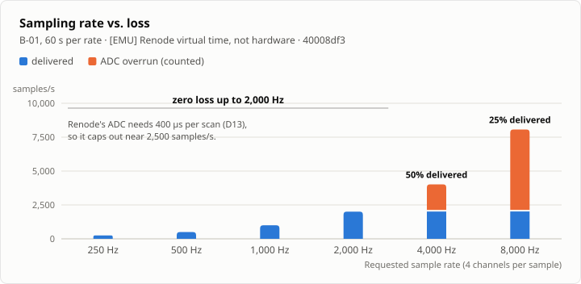
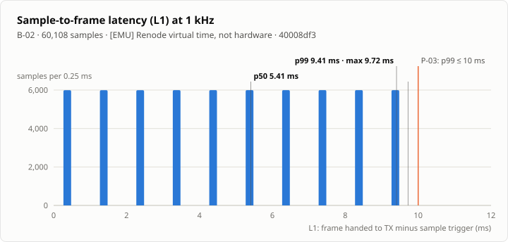
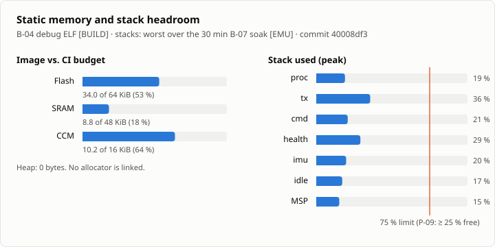
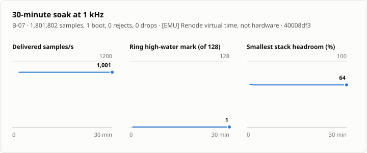
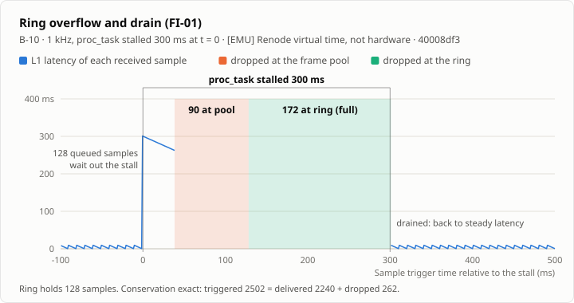
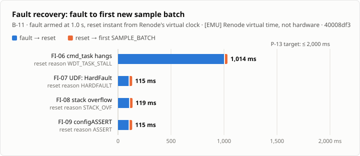
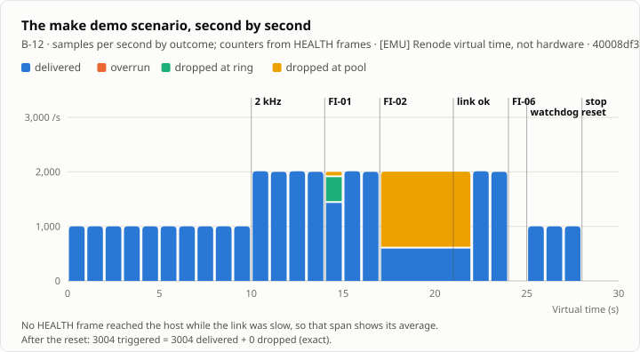

# Results

Generated by `bench/report.py` from `bench/results/`. Do not edit by hand. Reproduce with:

```sh
make fw && . ~/.cache/rttelemetry-tools/env.sh && python bench/bench.py && make results
```

**Labels.** `[EMU]` means Renode 1.17.0 virtual time: deterministic and reproducible, but not cycle-accurate, so timing and CPU numbers do not predict silicon. `[HOST]` means a host-side computation. `[BUILD]` means read from the linked ELF. `[CALC]` means a paper calculation. **No result on this page was measured on hardware.**

### B-01 Rate sweep (60 s virtual per rate)

| Rate | Triggered | Received | Overrun | Ring drop | Pool drop | CPU (mean) | L1 max | L2 max | Ring HWM | Conservation exact | Zero loss |
|---|---|---|---|---|---|---|---|---|---|---|---|
| 250 Hz | 15103 [EMU] | 15103 [EMU] | 0 [EMU] | 0 [EMU] | 0 [EMU] | 2.3 % [EMU] | 20.5 ms [EMU] | 463 µs [EMU] | 1 [EMU] | yes | yes |
| 500 Hz | 30114 [EMU] | 30114 [EMU] | 0 [EMU] | 0 [EMU] | 0 [EMU] | 3.2 % [EMU] | 18.5 ms [EMU] | 673 µs [EMU] | 1 [EMU] | yes | yes |
| 1000 Hz | 60159 [EMU] | 60159 [EMU] | 0 [EMU] | 0 [EMU] | 0 [EMU] | 5.1 % [EMU] | 9.7 ms [EMU] | 672 µs [EMU] | 1 [EMU] | yes | yes |
| 2000 Hz | 120340 [EMU] | 120340 [EMU] | 0 [EMU] | 0 [EMU] | 0 [EMU] | 9.1 % [EMU] | 9.4 ms [EMU] | 599 µs [EMU] | 1 [EMU] | yes | yes |
| 4000 Hz | 241062 [EMU] | 120581 [EMU] | 120481 [EMU] | 0 [EMU] | 0 [EMU] | 9.2 % [EMU] | 9.4 ms [EMU] | 598 µs [EMU] | 1 [EMU] | yes | no |
| 8000 Hz | 483969 [EMU] | 121068 [EMU] | 362901 [EMU] | 0 [EMU] | 0 [EMU] | 9.3 % [EMU] | 9.4 ms [EMU] | 507 µs [EMU] | 1 [EMU] | yes | no |

L1/L2 max, CPU and ring HWM are steady-state: they are taken from the last HEALTH frame before `SET_RATE 0`, because the final partial batch waits for the 20 ms flush by design. At 250 and 500 Hz, a 10-sample batch takes longer than 20 ms to fill, so L1 is bounded by the flush timer and the proc wake period instead.

Max zero-loss rate: **2000 Hz [EMU]**. The emulated ADC needs 400 µs per 4-channel scan (D13), so 4 kHz and 8 kHz overrun by construction in Renode. The overruns are counted and conservation still holds. Silicon scan time is about 33 µs `[CALC]`; the zero-loss rate on hardware is untested. CPU load is FreeRTOS run-time stats in virtual time. Renode is not cycle-accurate, so this is not a silicon CPU figure.



Commit `40008df3`, arm-none-eabi-gcc (Arm GNU Toolchain 15.2.Rel1 (Build arm-15.86)) 15.2.1 20251203, Renode 1.17.0, FreeRTOS V11.3.3, Python 3.12.13, host Darwin 27.0.0 arm64.

### B-02 Latency at 1 kHz (60108 samples)

| Metric | p50 | p90 | p99 | max |
|---|---|---|---|---|
| L1 [EMU] | 5.41 ms | 8.72 ms | 9.41 ms | 9.72 ms |
| L2 [EMU] | - | - | - | 672 µs (device max) |

L1 is SAMPLE_BATCH frame t_us (handed to TX) minus sample t_us (trigger), per sample, steady state (excludes the final stop-and-flush batch). Target P-03: p99 ≤ 10 ms, max ≤ 12 ms. L2 percentiles and E2E need the per-frame TX start time (HW logic analyzer); device reports L2 max only.

The L1 histogram has one spike per 1 ms sample period: a sample's latency is set by its position in the 10-sample batch. Emulated timers have no jitter, so the spikes are sharp; silicon would spread them (B-06).



Commit `40008df3`, arm-none-eabi-gcc (Arm GNU Toolchain 15.2.Rel1 (Build arm-15.86)) 15.2.1 20251203, Renode 1.17.0, FreeRTOS V11.3.3, Python 3.12.13, host Darwin 27.0.0 arm64.

### B-04 Memory (`build/fw-debug/src/telemetry.elf`)

| Section | Bytes [BUILD] |
|---|---|
| .isr_vector | 392 |
| .text | 32540 |
| .rodata | 1860 |
| .ARM | 8 |
| .init_array | 4 |
| .fini_array | 4 |
| .data | 12 |
| .bss | 8820 |
| .noinit | 168 |
| .msp | 2048 |
| .ccm | 8448 |

Heap: **0 bytes** (no allocator linked; `scripts/check_no_heap.sh`).

Top 20 symbols:

| Symbol | Type | Bytes [BUILD] |
|---|---|---|
| `ring_storage` | b | 2560 |
| `cmd_stack` | b | 1536 |
| `health_stack` | b | 1536 |
| `imu_stack` | b | 1536 |
| `proc_stack` | b | 1536 |
| `tx_stack` | b | 1536 |
| `pool` | b | 1008 |
| `build_health` | t | 1000 |
| `__udivmoddi4` | T | 800 |
| `fi_mem` | b | 768 |
| `msg_put_health` | T | 660 |
| `tx_task` | T | 600 |
| `xTaskIncrementTick` | T | 552 |
| `xTaskGenericNotify` | T | 540 |
| `xTaskResumeAll` | T | 520 |
| `rx_storage` | b | 512 |
| `table` | r | 512 |
| `uxIdleTaskStack.0` | b | 512 |
| `i2c_read_reg` | T | 508 |
| `vTaskGenericNotifyGiveFromISR` | T | 496 |

Stacks after the 1 kHz sweep run (the 8 kHz stress margins are checked by IT-STRESS-1, ≥ 25 %):

| Task | Configured (words) | Min free (words) [EMU] | Used |
|---|---|---|---|
| proc | 384 | 313 | 18.5 % |
| tx | 384 | 247 | 35.7 % |
| cmd | 384 | 304 | 20.8 % |
| health | 384 | 282 | 26.6 % |
| imu | 384 | 310 | 19.3 % |
| idle | 128 | 106 | 17.2 % |
| MSP (bytes) | 2048 | 1752 | 14.5 % |



Commit `40008df3`, arm-none-eabi-gcc (Arm GNU Toolchain 15.2.Rel1 (Build arm-15.86)) 15.2.1 20251203, Renode 1.17.0, FreeRTOS V11.3.3, Python 3.12.13, host Darwin 27.0.0 arm64.

### B-05 Backpressure: 1 kHz over an emulated 115200-baud link (30 s)

The link is emulated with FI-02 (`TX_DELAY` = 87 µs/byte, rounded up to 1 ms per frame). It is not a real 115200-baud UART.

| Metric | Value |
|---|---|
| Steady-state ADC samples delivered | 472.4 Hz [EMU] |
| `[CALC]` for SAMPLE_BATCH frames alone | 587 Hz |
| Dropped at ring / pool / overrun | 0 / 15630 / 0 [EMU] |
| Conservation exact | yes |

Drops happen at the frame pool, not the ring: proc keeps up, and the link is the bottleneck. IMU, HEALTH and EVENT frames share the emulated 115200-baud link, so the ADC sample rate delivered is below the samples-only [CALC] figure.

| Frame type | Bytes on wire [EMU] |
|---|---|
| ACK | 54 |
| BOOT | 116 |
| EVENT | 132 |
| HEALTH | 450 |
| IMU_BATCH | 49278 |
| SAMPLE_BATCH | 290080 |

Commit `40008df3`, arm-none-eabi-gcc (Arm GNU Toolchain 15.2.Rel1 (Build arm-15.86)) 15.2.1 20251203, Renode 1.17.0, FreeRTOS V11.3.3, Python 3.12.13, host Darwin 27.0.0 arm64.

### B-07 Soak (30 min virtual at 1 kHz)

| Metric | Value |
|---|---|
| Samples received | 1801802 [EMU] |
| Boots (1 = no reset) | 1 [EMU] |
| Decoder rejects (CRC/COBS) | 0 [EMU] |
| Drops (overrun / ring / pool) | 0 / 0 / 0 [EMU] |
| Conservation exact | yes |
| Min task stack free (words) | proc 311, tx 247, cmd 304, health 272, imu 308, idle 106 [EMU] |

P-10 (EMU, ≥ 10⁶ samples, 0 CRC errors, 0 unaccounted). The per-minute series (delivered rate, ring HWM, pool and stack headroom, CPU, L1 max) is in the result JSON and plotted below.



Commit `40008df3`, arm-none-eabi-gcc (Arm GNU Toolchain 15.2.Rel1 (Build arm-15.86)) 15.2.1 20251203, Renode 1.17.0, FreeRTOS V11.3.3, Python 3.12.13, host Darwin 27.0.0 arm64.

### B-08 Protocol overhead at 1 kHz

| Metric | Measured [EMU] | `[CALC]` (PRD §12.4) |
|---|---|---|
| SAMPLE_BATCH, 10 samples, on wire | 196 B | 196 B |
| All frames, bytes/s | 24609 | - |
| Link utilization at 921600 baud | 26.7 % | - |

| Frame type | Bytes [EMU] |
|---|---|
| ACK | 54 |
| BOOT | 116 |
| EVENT | 93 |
| HEALTH | 9150 |
| IMU_BATCH | 288028 |
| SAMPLE_BATCH | 1179118 |

Commit `40008df3`, arm-none-eabi-gcc (Arm GNU Toolchain 15.2.Rel1 (Build arm-15.86)) 15.2.1 20251203, Renode 1.17.0, FreeRTOS V11.3.3, Python 3.12.13, host Darwin 27.0.0 arm64.

### B-09 Corruption Monte Carlo (FI-11, P-11)

| Error | Trials | Undetected [HOST] | Detected [HOST] | Neighbour frames lost |
|---|---|---|---|---|
| 1bit | 25000 | 0 | 100.000 % | 130 |
| 2bit | 25000 | 0 | 100.000 % | 249 |
| 3bit | 25000 | 0 | 100.000 % | 366 |
| burst<=16 | 25000 | 0 | 100.000 % | 115 |

Stream: first 200 frames of a 1.2 s nominal capture; seed 1. The corrupted frame is always rejected. Neighbour loss happens only when a flip creates or destroys a 0x00 delimiter.

Commit `40008df3`, arm-none-eabi-gcc (Arm GNU Toolchain 15.2.Rel1 (Build arm-15.86)) 15.2.1 20251203, Renode 1.17.0, FreeRTOS V11.3.3, Python 3.12.13, host Darwin 27.0.0 arm64.

### B-10 Ring overflow and drain (FI-01: `proc_task` stalls 300 ms at 1000 Hz)

| Metric | Value |
|---|---|
| Dropped at ring / pool / overrun | 172 / 90 / 0 [EMU] |
| `[CALC]` ring drops | stall / sample period - ring capacity = 300 / 0.999 - 128 = 172 |
| Missing sequence numbers at the host | 262 [EMU] (= ring + pool drops) |
| L1 max before the stall / peak | 9.407 ms / 300.967 ms [EMU] |
| Back to steady-state L1 | 301.16 ms after the stall began [EMU] |
| Conservation exact | yes: 2502 = 2240 + 262 |

The samples already queued wait out the stall and are delivered late. The frame pool fills first, then the ring; every lost sample is counted where it was dropped, and the host sees exactly that many missing sequence numbers. The first sample triggered after the stall already has steady-state latency.



Commit `40008df3`, arm-none-eabi-gcc (Arm GNU Toolchain 15.2.Rel1 (Build arm-15.86)) 15.2.1 20251203, Renode 1.17.0, FreeRTOS V11.3.3, Python 3.12.13, host Darwin 27.0.0 arm64.

### B-11 Fault recovery (P-13, P-14; armed 1 s after boot)

| Fault | Injected | BOOT reset reason | Fault to reset | Boot to first batch | Total recovery | Overruns after reset | Conservation after reset |
|---|---|---|---|---|---|---|---|
| FI-06 | cmd_task hangs | `WDT_TASK_STALL` (task `cmd`) | 999.8 ms [EMU] | 13.922 ms [EMU] | 1013.722 ms [EMU] | 3 | yes |
| FI-07 | UDF: HardFault | `HARDFAULT` (task `cmd`) | 100.6 ms [EMU] | 13.915 ms [EMU] | 114.515 ms [EMU] | 3 | yes |
| FI-08 | stack overflow | `STACK_OVF` (task `fi`) | 104.6 ms [EMU] | 13.915 ms [EMU] | 118.515 ms [EMU] | 3 | yes |
| FI-09 | configASSERT | `ASSERT` (task `cmd`) | 100.6 ms [EMU] | 13.915 ms [EMU] | 114.515 ms [EMU] | 3 | yes |

Power-on to first batch: 10.901 ms [EMU]. Targets: P-13 recovery ≤ 2000 ms; P-14 boot to first batch ≤ 100 ms. Timing: reset_after_ms runs from the FI_ARM command entering USART2 to the reset, on Renode's virtual clock. boot_to_first_batch_ms is the first SAMPLE_BATCH frame's device timestamp, so it excludes the startup code before TIM2 starts. The 3 overruns after each reset are the first ADC scan, which stalled after each of these resets in Renode (D16) and was aborted after 2 ms, plus the triggers that arrived while it was in flight. All are counted.



Commit `40008df3`, arm-none-eabi-gcc (Arm GNU Toolchain 15.2.Rel1 (Build arm-15.86)) 15.2.1 20251203, Renode 1.17.0, FreeRTOS V11.3.3, Python 3.12.13, host Darwin 27.0.0 arm64.

### B-12 `make demo` timeline

| t (virtual) | Step |
|---|---|
| 10 s | SET_RATE 2000 Hz |
| 14 s | FI-01: proc_task stalls 300 ms -> ring overflows, then drains |
| 17 s | FI-02: slow link (200 us/byte) -> drops move to the frame pool |
| 21 s | FI_CLEAR: link back to normal |
| 24 s | FI-06: cmd_task hangs -> supervisor stops kicking -> IWDG reset |
| 28 s | SET_RATE 0: stop + flush, then GET_STATUS for the final counters |
| 29 s | GET_STATUS |

Resets observed: 1 (at 24.9988 s, `WDT_TASK_STALL`, task `cmd`). Conservation over the last boot: 3004 triggered = 3004 delivered + 0 dropped, exact. Decoder rejects: 0.



Commit `40008df3`, arm-none-eabi-gcc (Arm GNU Toolchain 15.2.Rel1 (Build arm-15.86)) 15.2.1 20251203, Renode 1.17.0, FreeRTOS V11.3.3, Python 3.12.13, host Darwin 27.0.0 arm64.

### Not run: hardware required

| ID | Benchmark | Why |
|---|---|---|
| B-03 | `ring_push`/`pop` vs FreeRTOS queues, DWT cycles | Renode does not model cycle timing |
| B-06 | Sampling jitter histogram, 10⁶ samples | Emulated timers have no jitter |
| B-02 (HW part) | End-to-end latency by logic analyzer | Needs board + analyzer |
| B-05 (HW part) | Real 115200-baud link | Needs board + USB-UART |
| B-07 (HW part) | 24 h soak | Needs board |
